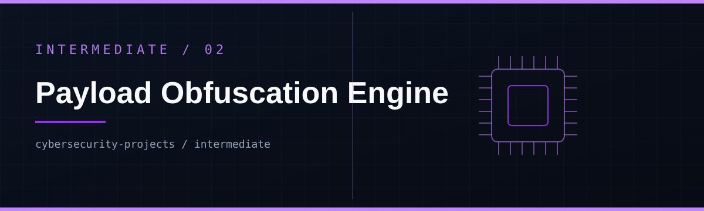
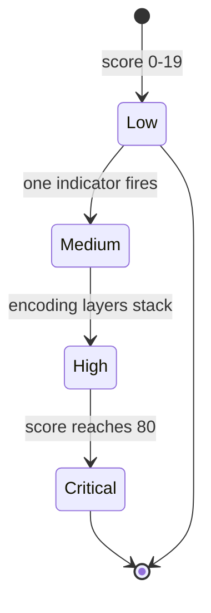

<div align="center">
  
</div>

<br />

<div align="center">

# 🔬 Payload Obfuscation Detector


> **Recognise the wrapper, never build one.** Ten textual indicators turn suspicious logs and scripts into a bounded risk score — without emitting a single transformed byte.

</div>

---

## 🎯 What it does

`analyze_text(text)` scans a string for obfuscation *fingerprints*: long base64 or hex runs that decode to printable bytes, dense `\xNN` / `\uNNNN` escapes, doubled backslashes, numeric XOR expressions, `xor_key`-style tokens near decode keywords, and repeated `chr()` / `ord()` calls. Two or more distinct encoding families add a `layered_encoding` bonus. Triggered weights are summed and capped at 100.

Reports name the indicator kind, offset, and detail — never the matched text itself.

> **Scope & safety.** Safety substitution: the upstream synopsis is an offensive *payload obfuscation engine*. This project is the defensive inverse: a detector that scores text for obfuscation indicators. It contains **no obfuscator, no encoder, no XOR routine, and no weaponized payload**. Base64/hex decoding is used only to validate that a candidate run is really encoded text; decoded bytes are counted and discarded, never printed or written. Python substitution: the upstream implementation language is replaced by a standard-library-only Python CLI. The learning goal shifts from producing obfuscated output to recognising its textual signatures in logs, emails, and scripts. This is an analysis tool for text you are authorised to inspect. It does not generate, execute, or transmit anything. A high score is a review hint, not proof of malice: legitimate build scripts and test data can trigger the same patterns.

## 🧠 How it works



Each indicator is appended in a fixed order, so the same text always produces the same `Detection`. Decoded bytes are tested for a printable ratio of at least 0.85, which stops ordinary alphanumeric words from being flagged as base64.

| Indicator | Signal | Weight |
|---|---|---|
| `base64` | run of 20+ base64 chars that decodes to printable bytes | 20 |
| `hex` | run of 32+ hex chars that decodes to printable bytes | 20 |
| `hex_escapes` | 8 or more `\xNN` sequences | 15 |
| `unicode_escapes` | 6 or more `\uNNNN` sequences | 10 |
| `escaped_string` | 12 or more escape sequences of any supported kind | 15 |
| `double_escape` | 4 or more doubled-backslash runs | 10 |
| `xor_literal` | numeric XOR expression such as `0x41 ^ 0x2a` | 20 |
| `xor_keyword` | `xor`/`xor_key` near `key`, `decode`, or `mask` | 15 |
| `char_codes` | 3 or more `chr()`/`ord()` calls | 10 |
| `layered_encoding` | two or more distinct encoding layers | 15 |

## 🚀 Quick start

```powershell
python obfuscation_detector.py --text "mask = 0x41 ^ 0x2a"
python obfuscation_detector.py --file sample.txt --json
```

The sample below is two encodings of the same harmless sentence — a base64 run followed by a space and a hex run — written to `%TEMP%` with Python before the CLI ran:

```text
c2FmZSBzeW50aGV0aWMgZml4dHVyZSB0ZXh0IGZvciBkZXRlY3RvciB0ZXN0cw== 736166652073796e7468657469632066697874757265207465787420666f72206465746563746f72207465737473
```

### Real output

```text
$ python obfuscation_detector.py --file sample.txt
Score: 55/100 (high)
Encoding layers: 2
  [+20] base64 @0: 64 chars decode to 46 bytes
  [+20] hex @65: 92 hex chars decode to 46 bytes
  [+15] layered_encoding @0: 2 distinct encoding layers
```

## 📂 Project structure

```text
02-payload-obfuscation-engine/
├── assets/hero.svg                    # generated visual identity
├── obfuscation_detector.py            # indicator engine + CLI
├── learn/README.md                    # why detection, not generation
└── tests/test_obfuscation_detector.py # 21 deterministic tests
```

## 🔍 Why it matters

- **Cheap triage.** A scanner can highlight suspicious text before a human opens it; it never has to understand the payload.
- **Layering is the tell.** One encoding is common in build systems; two families in the same string is a much stronger review signal.
- **Do no harm.** Decoded bytes are discarded, so a detector cannot accidentally become a distribution channel for what it finds.

## 🧪 Tests

```powershell
python -m unittest discover -s tests -v
```

21 tests covering clean text, valid and invalid base64/hex runs, escape sequences, XOR markers, character codes, score capping, severity thresholds, report shape, and the CLI. Standard library only, no network calls; every fixture is synthetic text generated inside the tests.

## 📚 Learn more

Read [the concept notes](learn/README.md) for the textual fingerprints, why the detection direction is the safe one, and the design choices behind fixed indicator order and conservative thresholds.

---

<div align="center">
  <sub>Part of <b>cybersecurity-projects</b> · Intermediate tier · Built from a synopsis, original implementation.</sub>
</div>
