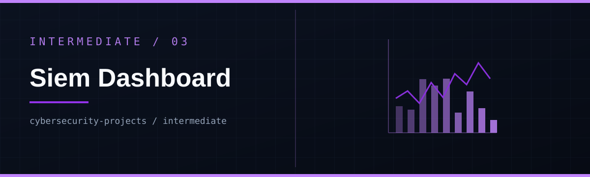
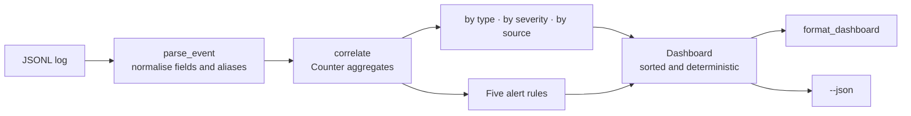

<div align="center">
  
</div>

<br />

<div align="center">

# 📊 SIEM Dashboard


> **Correlation without the chrome.** JSONL goes in, counts and rule-based alerts come out — the useful half of a SIEM, with none of the web stack.

</div>

---

## 🎯 What it does

Each line of a local JSONL log is normalised into an `Event` with consistent field names and lower-cased type/severity. `correlate()` builds `Counter`-based aggregates by event type, severity, and source IP, then evaluates five small rules: `failed_login_burst`, `high_severity_events`, `off_hours_activity`, `many_failed_users`, and `firewall_block_burst`. `--threshold` defaults to 5; the report is sorted by count, severity, and rule name so repeated runs are identical. No wall-clock time is read.

> **Scope & safety.** Python substitution: the upstream project uses Flask plus React for a web dashboard. This version replaces that stack with a standard-library Python CLI. There is no web server, no browser, no database, and no live log source; `--json` provides the machine-readable output a frontend would have consumed. Deviation from upstream: visualisation is dropped in favour of deterministic text/JSON reports. This tool only analyses a JSONL file you provide. It does not connect to log collectors, endpoints, or production SIEM systems. Counts and alerts are examples of correlation logic, not evidence about any real environment.

## 🧠 How it works



Recognised keys are `timestamp` (alias `time`), `event_type` (alias `type`), `source_ip` (alias `ip`), `user`, `host`, `severity`, and `message`; missing fields get safe defaults. Naive timestamps are treated as UTC, so off-hours verdicts cannot change with the host timezone.

## 🚀 Quick start

```powershell
python siem_dashboard.py events.jsonl
python siem_dashboard.py events.jsonl --json --threshold 3
```

The log used below was written to `%TEMP%` with Python. It holds five `failed_login` events from one address between 23:00 and 23:04, one firewall block, and one critical informational event:

```json
{"timestamp": "2026-11-20T23:00:00Z", "event_type": "failed_login", "source_ip": "192.0.2.10", "user": "user-0", "severity": "info"}
{"timestamp": "2026-11-20T23:01:00Z", "event_type": "failed_login", "source_ip": "192.0.2.10", "user": "user-1", "severity": "info"}
{"timestamp": "2026-11-20T23:02:00Z", "event_type": "failed_login", "source_ip": "192.0.2.10", "user": "user-2", "severity": "info"}
{"timestamp": "2026-11-20T23:03:00Z", "event_type": "failed_login", "source_ip": "192.0.2.10", "user": "user-3", "severity": "info"}
{"timestamp": "2026-11-20T23:04:00Z", "event_type": "failed_login", "source_ip": "192.0.2.10", "user": "user-4", "severity": "info"}
{"timestamp": "2026-11-20T12:00:00Z", "event_type": "firewall_block", "source_ip": "192.0.2.20", "severity": "low"}
{"timestamp": "2026-11-20T13:00:00Z", "event_type": "info", "source_ip": "192.0.2.30", "severity": "critical"}
```

### Real output

```text
$ python siem_dashboard.py events.jsonl --threshold 3
SIEM Dashboard (synthetic events)
Total events: 7
By type:
  failed_login: 5
  firewall_block: 1
  info: 1
By severity:
  info: 5
  critical: 1
  low: 1
Top source IPs:
  192.0.2.10: 5
  192.0.2.20: 1
  192.0.2.30: 1
Alerts:
  [HIGH    ] failed_login_burst: 192.0.2.10: 5 failed logins
  [HIGH    ] high_severity_events: 1 high/critical events
  [MEDIUM  ] many_failed_users: 5 distinct users with failed logins
  [MEDIUM  ] off_hours_activity: 5 events between 22:00 and 06:00
```

## 📂 Project structure

```text
03-siem-dashboard/
├── assets/hero.svg               # generated visual identity
├── siem_dashboard.py             # event model + correlation + CLI
├── learn/README.md               # the four steps of a SIEM, determinism
└── tests/test_siem_dashboard.py  # 21 deterministic tests
```

## 🔍 Why it matters

- **Rules make data actionable.** A count of failed logins is a fact; a per-source burst alert is something an analyst can act on.
- **Determinism is a feature.** Sorted aggregates and alerts mean a report can be diffed, tested, and trusted in CI.
- **Thresholds are policy.** Five events might be a burst or a shared NAT gateway — the mechanism is the lesson, not the number.

## 🧪 Tests

```powershell
python -m unittest discover -s tests -v
```

21 tests covering field aliases, defaults, bad JSON and timestamps, blank lines, deterministic counts, each alert rule and its threshold boundary, severity ordering, report sections, and CLI output. Standard library only, no network calls; all events are synthetic records created inside the tests.

## 📚 Learn more

Read [the concept notes](learn/README.md) for ingest → normalise → aggregate → alert, why the CLI replaces the web stack, and how deterministic sorting is enforced.

---

<div align="center">
  <sub>Part of <b>cybersecurity-projects</b> · Intermediate tier · Built from a synopsis, original implementation.</sub>
</div>
