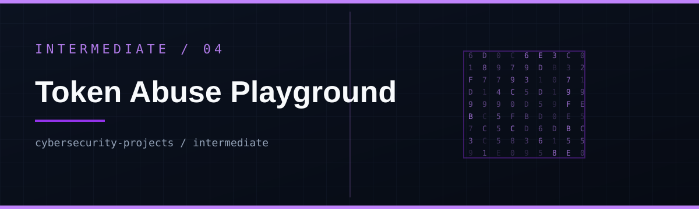
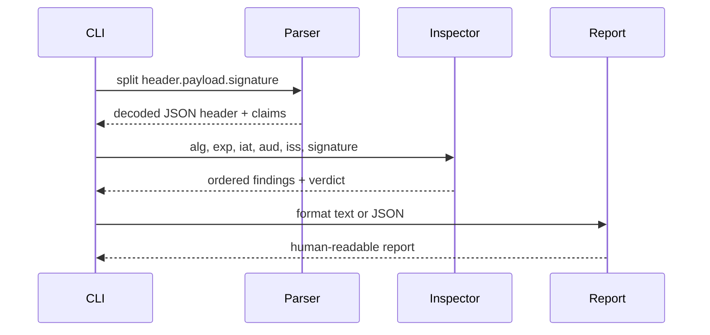

<div align="center">
  
</div>

<br />

<div align="center">

# 🎟️ Token Abuse Playground


> **Read the claims, refuse the romance.** A parse-only inspector that says what a token *claims* — and is explicit about the one thing it cannot prove.

</div>

---

## 🎯 What it does

`parse_token()` splits a three-segment token and base64url-decodes the header and payload into dictionaries. `inspect_token()` then checks the algorithm, expiry, issued-at time, audience, issuer, empty signatures, and lifetime, returning an immutable `Inspection` with ordered findings and a verdict. Any critical or high finding means `reject`; medium-only means `review`; otherwise `allow`. The third segment stays opaque text.

> **Scope & safety.** Safety substitution: the upstream topic covers abusing tokens. This project implements the defensive counterpart only. It parses tokens, checks `exp`, `iat`, `aud`, `iss`, and flags weak `alg: none`. It does **not** forge tokens, sign them, brute-force secrets, bypass verification, or contact any service. Signature segments are treated as opaque text and are never cryptographically verified. Python substitution: the upstream implementation is replaced with a standard-library-only Python CLI. The lab uses synthetic three-segment strings produced inside the tests, so no real credentials or production tokens are involved. Inspect only tokens you are authorised to review. A clean report does not prove a token is genuine — this tool never verifies signatures and makes no claim of cryptographic authenticity.

## 🧠 How it works



Passing `--now` makes time-based checks a pure function of the input; omit it and the checks are skipped with a `time_reference_missing` finding. `--expect-aud` and repeatable `--trusted-issuer` supply the policy being checked against.

| Code | Severity | Meaning |
|---|---|---|
| `alg_none` | critical | header declares `alg: none` |
| `alg_missing` | high | no algorithm declared |
| `unsigned_token` | high | empty third segment |
| `expired` / `exp_missing` / `exp_invalid` | high / medium / medium | expiry problems |
| `iat_in_future` / `iat_missing` / `iat_invalid` | medium / low / medium | issued-at problems |
| `iat_after_exp` / `long_lifetime` | medium / low | claim consistency and lifetime |
| `aud_mismatch` / `aud_missing` | high / medium | audience problems |
| `iss_untrusted` / `iss_missing` | high / medium | issuer problems |
| `time_reference_missing` | low | no `--now` supplied |

## 🚀 Quick start

```powershell
python token_inspector.py --token "<header>.<payload>.<signature>" --now 2026-11-20T00:00:00Z
python token_inspector.py --file token.txt --json --expect-aud lab-api --trusted-issuer https://issuer.example.test
```

The `token.txt` below was written to `%TEMP%` with Python. Its header declares `alg: none`, its `exp` is 19 November 2026, and its signature segment is empty — three deliberate defects in a synthetic string:

```json
{"alg": "none", "typ": "JWT"}
{"exp": 1795046400, "iat": 1794960000, "aud": "lab-api", "iss": "https://issuer.example.test"}
<empty signature segment>
```

### Real output

```text
$ python token_inspector.py --file token.txt --now 2026-11-20T00:00:00Z --expect-aud lab-api --trusted-issuer https://issuer.example.test
Verdict: REJECT
alg: none
exp: 1795046400  iat: 1794960000
aud: lab-api  iss: https://issuer.example.test
Findings:
  [CRITICAL] alg_none: alg=none disables signature verification
  [HIGH    ] unsigned_token: third segment is empty; token is unsigned
  [HIGH    ] expired: exp=1795046400 is not in the future
```

## 📂 Project structure

```text
04-token-abuse-playground/
├── assets/hero.svg                # generated visual identity
├── token_inspector.py             # parser + claim checks + CLI
├── learn/README.md                # token anatomy and limits of inspection
└── tests/test_token_inspector.py  # 27 deterministic tests
```

## 🔍 Why it matters

- **`alg: none` is a loud signal.** Historically some libraries accepted it and skipped verification entirely.
- **Claims are intent, not identity.** Anyone can write arbitrary JSON into the first two segments; that is why findings are reported rather than trusted.
- **Honest limits.** A clean report means "no structural problems found", never "cryptographically valid".

## 🧪 Tests

```powershell
python -m unittest discover -s tests -v
```

27 tests covering segment parsing and malformed input, every claim rule, verdict aggregation, ordered findings, report and JSON shape, and CLI behaviour. Standard library only, no network calls; all tokens are synthetic test fixtures.

## 📚 Learn more

Read [the concept notes](learn/README.md) for JWT-like anatomy, what each claim check means, why there is no signing code, and the design notes behind explicit time references.

---

<div align="center">
  <sub>Part of <b>cybersecurity-projects</b> · Intermediate tier · Built from a synopsis, original implementation.</sub>
</div>
