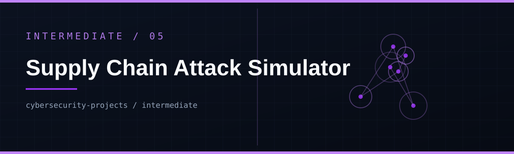
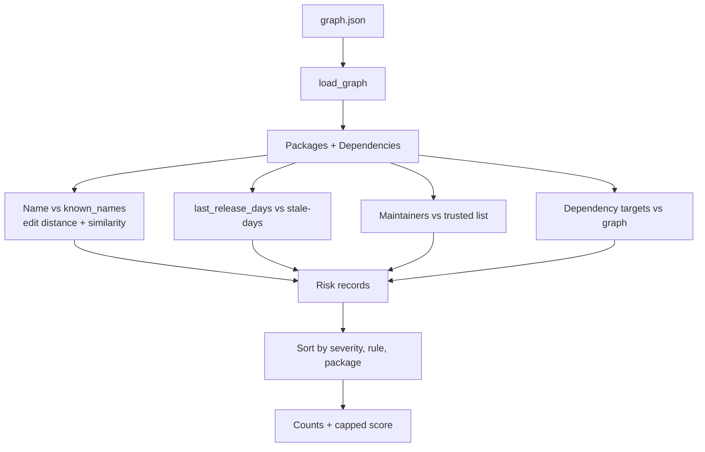

<div align="center">
  
</div>

<br />

<div align="center">

# 🧩 Supply-Chain Graph Risk Analyzer


> **Trust is a graph problem.** Names, maintainers, and release gaps become five checkable signals — no packages touched, no registry called.

</div>

---

## 🎯 What it does

`analyze_graph()` walks a synthetic package/dependency description and flags five risk rules: `typosquat_like` (one edit or high similarity to a known name), `unmaintained` (stale last release), `unexpected_maintainer`, `unknown_maintainer`, and `unknown_dependency`. Levenshtein distance plus `difflib.SequenceMatcher` drive name similarity. Severity points are high 20, medium 10, low 5, capped at 100; risks and counts are sorted for reproducible output.

> **Scope & safety.** Safety substitution: the upstream synopsis is a supply-chain *attack simulator*. This project only analyses a local JSON description of packages and relationships. It flags risk signals; it does **not** create malicious packages, download dependencies, build artefacts, publish to a registry, or execute package code. Python substitution: the upstream implementation is replaced by a standard-library-only Python CLI. All packages, maintainers, and names in the tests are synthetic strings, so nothing can be installed or harmed. Name similarity and staleness are weak signals: a legitimate package can look similar to a popular one, and quiet maintenance does not prove compromise. Treat findings as prompts for human review.

## 🧠 How it works



The maintainer rules only run when `trusted_maintainers` is supplied — without a baseline there is nothing to compare against. `last_release_days` is data, so no registry lookup or system clock is needed.

## 🚀 Quick start

```powershell
python dependency_analyzer.py --graph graph.json
python dependency_analyzer.py --graph graph.json --json --stale-days 180
```

Graph file format, using the synthetic fixture written to `%TEMP%` with Python for the run below:

```json
{
  "packages": [
    {"name": "reqests", "version": "1.0.0", "maintainers": ["alice"], "last_release_days": 20},
    {"name": "legacy-utils", "version": "0.9", "maintainers": ["alice"], "last_release_days": 500},
    {"name": "api-app", "version": "2.1.0", "maintainers": ["alice"], "last_release_days": 10}
  ],
  "dependencies": [
    {"source": "api-app", "target": "reqests", "kind": "runtime"},
    {"source": "api-app", "target": "ghost-pkg", "kind": "runtime"}
  ],
  "known_names": ["requests", "flask"],
  "trusted_maintainers": ["alice"]
}
```

### Real output

```text
$ python dependency_analyzer.py --graph graph.json
Supply-chain graph risk score: 40/100
Counts:
  typosquat_like: 1
  unknown_dependency: 1
  unmaintained: 1
Risks:
  [HIGH  ] typosquat_like (reqests): similar to known name(s): requests
  [MEDIUM] unknown_dependency (api-app): depends on unlisted package 'ghost-pkg'
  [MEDIUM] unmaintained (legacy-utils): 500 days since last release (limit 365)
```

## 📂 Project structure

```text
05-supply-chain-attack-simulator/
├── assets/hero.svg                     # generated visual identity
├── dependency_analyzer.py              # graph model + rules + CLI
├── learn/README.md                     # dependency trust signals
└── tests/test_dependency_analyzer.py   # 24 deterministic tests
```

## 🔍 Why it matters

- **Names can be weaponised.** A one-character difference from a popular package is worth a second look before install time.
- **Metadata carries evidence.** Staleness and maintainer changes are cheap to inspect and impossible to verify by trusting a lockfile alone.
- **An evidence gap is not an accusation.** An unlisted dependency is reported separately from a claim about that missing package.

## 🧪 Tests

```powershell
python -m unittest discover -s tests -v
```

24 tests covering edit distance, typo candidates, every risk rule and its boundary, sorting and score capping, graph loading and validation, and CLI output. Standard library only, no network calls; every graph fixture is synthetic.

## 📚 Learn more

Read [the concept notes](learn/README.md) for the three trust signals, why the attack simulator became an analyzer, and the design notes behind stable ordering and capped scores.

---

<div align="center">
  <sub>Part of <b>cybersecurity-projects</b> · Intermediate tier · Built from a synopsis, original implementation.</sub>
</div>
