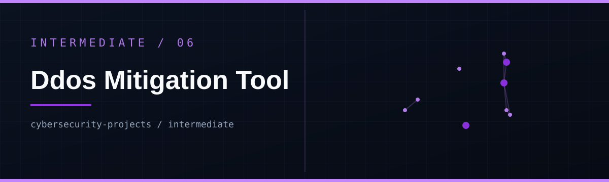
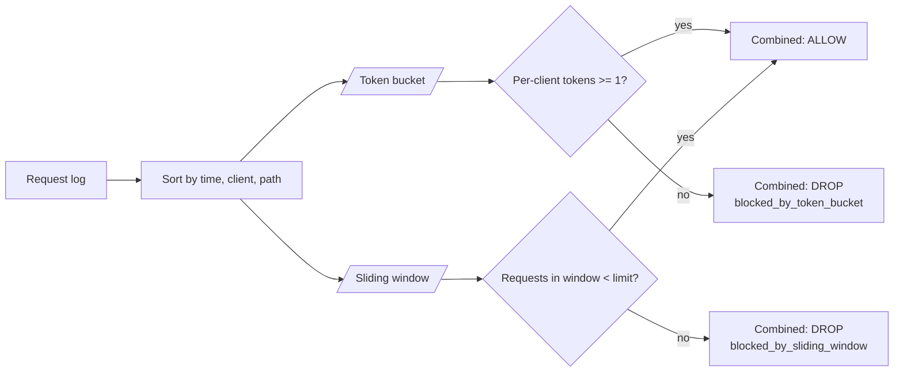

<div align="center">
  
</div>

<br />

<div align="center">

# 🚦 DDoS Mitigation Simulator


> **Replay, don't react.** Two classic rate limiters judge a synthetic request log and name exactly which one said no.

</div>

---

## 🎯 What it does

`simulate()` sorts a request log by `(time, client, path)` and runs two independent algorithms per client. **Token bucket** spends one token per request and refills at `rate` tokens per second up to `capacity`, so short bursts pass. **Sliding window** allows at most `window-limit` requests in the last `window` seconds, giving a hard count cap. A request survives only when both agree; the report attributes every drop to `blocked_by_token_bucket` or `blocked_by_sliding_window`.

> **Scope & safety.** Safety substitution: the upstream synopsis is a live DDoS mitigation tool. This project performs no live capture, opens no sockets, sends no traffic, and changes no firewall or router state. It only reads a local JSONL log (or generates a deterministic demo log) and reports which requests the algorithms would have allowed or dropped. Python substitution: the upstream implementation is replaced by a standard-library-only Python CLI. All client addresses are documentation/test addresses from `192.0.2.0/24` and every request is synthetic. This is an educational simulation. Real mitigation needs accurate time sources, distributed state, careful allowlists, and operational oversight; none of that is modelled here. Do not use this tool against live traffic or infrastructure.

## 🧠 How it works



`--demo` produces a seeded log via `random.Random(seed)`, so the same count and seed yield the same requests on every machine. Timestamps are synthetic floating-point seconds from the start of the simulation and are never compared with the system clock.

## 🚀 Quick start

```powershell
python traffic_shaper.py --demo --count 20 --json
python traffic_shaper.py --log requests.jsonl --capacity 5 --rate 1 --window-limit 10 --window 60
```

Each JSONL line has `time`, `client`, and an optional `path`:

```json
{"time": 0.0, "client": "192.0.2.10", "path": "/login"}
```

### Real output

```text
$ python traffic_shaper.py --demo --count 12 --capacity 2 --rate 1 --window-limit 3 --window 10
Traffic shaping simulation (synthetic log)
Requests: 12
Allowed: 6
Dropped: 6
token_bucket allowed: 9
sliding_window allowed: 7
Decisions:
  t=0.228 client=192.0.2.10 path=/login ALLOW both_allowed
  t=0.636 client=192.0.2.10 path=/api ALLOW both_allowed
  t=0.738 client=192.0.2.12 path=/ ALLOW both_allowed
  t=1.288 client=192.0.2.10 path=/ ALLOW both_allowed
  t=1.386 client=192.0.2.11 path=/ ALLOW both_allowed
  t=1.568 client=192.0.2.12 path=/login ALLOW both_allowed
  t=1.650 client=192.0.2.12 path=/ DROP  blocked_by_token_bucket
  t=2.221 client=192.0.2.12 path=/api DROP  blocked_by_sliding_window
  t=2.592 client=192.0.2.10 path=/api DROP  blocked_by_sliding_window
  t=2.964 client=192.0.2.10 path=/ DROP  blocked_by_token_bucket
  t=3.040 client=192.0.2.10 path=/login DROP  blocked_by_token_bucket
  t=3.320 client=192.0.2.12 path=/ DROP  blocked_by_sliding_window
```

## 📂 Project structure

```text
06-ddos-mitigation-tool/
├── assets/hero.svg              # generated visual identity
├── traffic_shaper.py            # both algorithms + simulator + CLI
├── learn/README.md              # token buckets and sliding windows
└── tests/test_traffic_shaper.py # 22 deterministic tests
```

## 🔍 Why it matters

- **Different questions, different answers.** A bucket shapes rate; a window enforces a count. Running both shows how a request can fail for two distinct reasons.
- **Per-client state matters.** One noisy address must not drain another address's budget.
- **Order-independent verdicts.** Sorting before processing means a shuffled log cannot change the outcome.

## 🧪 Tests

```powershell
python -m unittest discover -s tests -v
```

22 tests covering bucket capacity and refill, per-client isolation, window expiry boundaries, combined attribution, deterministic generation, log loading and validation, and CLI output. Standard library only, no network calls; the demo log uses a fixed seed.

## 📚 Learn more

Read [the concept notes](learn/README.md) for the two rate-limiting models, why the simulation stays offline, and the design choices behind sorting and exclusive window expiry.

---

<div align="center">
  <sub>Part of <b>cybersecurity-projects</b> · Intermediate tier · Built from a synopsis, original implementation.</sub>
</div>
