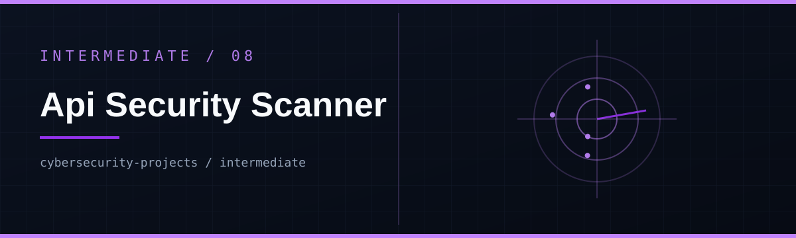
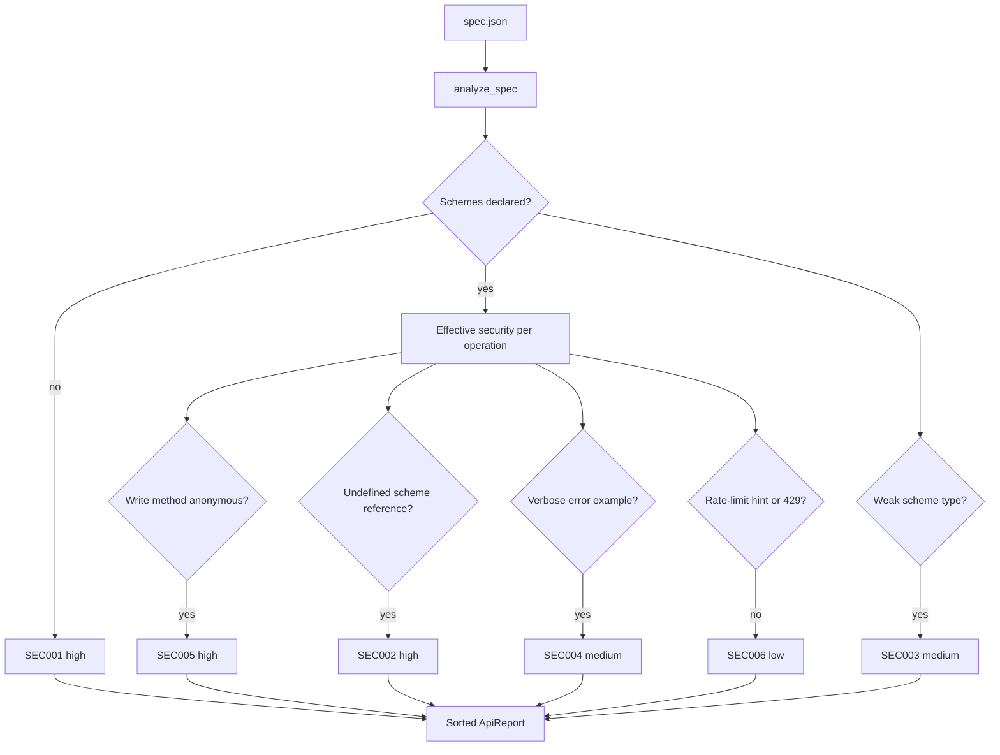

<div align="center">
  
</div>

<br />

<div align="center">

# 🧾 API Security Scanner


> **Audit the contract, not the server.** Six static rules read an OpenAPI-like JSON document and report weak auth, anonymous writes, and chatty errors — without a single request.

</div>

---

## 🎯 What it does

`analyze_spec()` walks every operation in a local specification and evaluates six rules. It resolves *effective* security by inheriting the top-level `security` list unless an operation overrides it (an empty list counts as anonymous), checks the declared schemes for weak authentication, and looks for verbose error examples and missing rate-limit hints. Findings are sorted by severity, rule, path, and method; `--strict` returns exit code 1 when anything is found, which makes the scanner pipeline-friendly.

> **Scope & safety.** Upstream stack: FastAPI + React, replaced by a Python CLI substitution. Only the Python standard library is installed here, so both the web UI and the HTTP-based upstream approach are replaced by deterministic static analysis of a local JSON document. **No HTTP requests are made.** Static analysis only. The tool reads one local JSON file; it never resolves hosts, sends requests, or modifies the specification.

## 🧠 How it works



`x-rate-limit`, a `429` response, or rate-limit wording in the summary/description satisfies SEC006. Weak schemes include HTTP basic/digest, API keys transported in the query string, and OAuth2 implicit flow.

| Rule | Severity | Check |
|---|---|---|
| SEC001 | high | Operations exist but no security scheme is declared. |
| SEC002 | high | A security requirement references an undefined scheme. |
| SEC003 | medium | Weak auth: HTTP basic/digest, API key in query, OAuth2 implicit. |
| SEC004 | medium | Response examples contain verbose error text. |
| SEC005 | high | Write operation with no effective authentication. |
| SEC006 | low | No rate-limit description, `x-rate-limit`, or `429` response. |

## 🚀 Quick start

```powershell
python api_security_scanner.py spec.json
python api_security_scanner.py spec.json --json --strict
```

The synthetic specification below was written to `%TEMP%` with Python for the run shown here:

```json
{
  "openapi": "3.0.3",
  "info": {"title": "Synthetic Widget API", "version": "1.0"},
  "components": {"securitySchemes": {"oldAuth": {"type": "http", "scheme": "basic"}}},
  "paths": {
    "/widgets": {
      "post": {
        "summary": "Create widget",
        "responses": {
          "201": {"description": "created"},
          "500": {"description": "failure", "content": {"application/json": {"example": {"detail": "Traceback (most recent call last): line 9"}}}}
        }
      }
    }
  }
}
```

### Real output

```text
$ python api_security_scanner.py spec.json
SEC005 (high) /widgets [post]: write operation has no effective authentication
SEC003 (medium) <components>: scheme 'oldAuth' uses reversible HTTP basic/digest credentials
SEC004 (medium) /widgets [post]: response 500 exposes verbose error details
SEC006 (low) /widgets [post]: no rate-limit description or 429 response
4 finding(s) across 1 operation(s), 1 scheme(s)
```

## 📂 Project structure

```text
08-api-security-scanner/
├── assets/hero.svg                 # generated visual identity
├── api_security_scanner.py         # rule engine + CLI
├── learn/README.md                 # contract auditing and effective security
└── tests/test_api_security_scanner.py # 14 deterministic tests
```

## 🔍 Why it matters

- **Contracts become behaviour.** Authentication and error-shape mistakes in a spec tend to show up in the deployed API.
- **Inherited security needs care.** A naive per-operation check either misses inherited auth or assumes every inherited operation is safe.
- **Cheap and safe to repeat.** Static analysis of one local document costs nothing and can run in every build.

## 🧪 Tests

```powershell
python -m unittest discover -s tests -v
```

14 deterministic tests covering all six rules, inherited and overridden security, weak scheme variants, verbose errors, severity filtering, invalid spec shapes, and CLI strict/clean modes. Synthetic specifications only; no HTTP requests or network access.

## 📚 Learn more

Read [the concept notes](learn/README.md) for contract auditing, effective security resolution, weak authentication signals, verbose-error detection, and exercises such as SARIF output.

---

<div align="center">
  <sub>Part of <b>cybersecurity-projects</b> · Intermediate tier · Built from a synopsis, original implementation.</sub>
</div>
