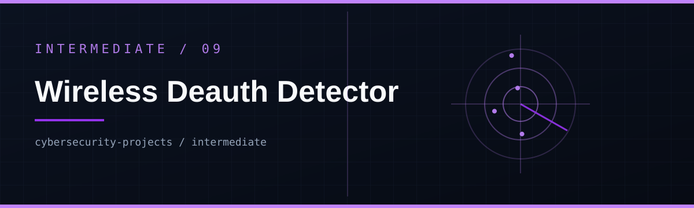
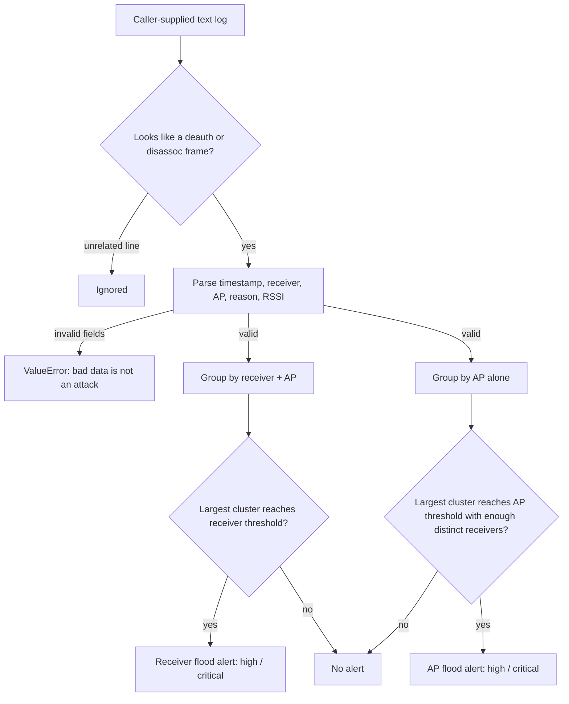

<div align="center">
  
</div>

<br />

<div align="center">

# 📡 Wireless Deauth Detector


> **A burst is the signal.** Two sliding-window groupings turn a line-oriented management-frame log into targeted and AP-wide flood alerts — without ever touching a radio.

</div>

---

## 🎯 What it does

It reads a text log of 802.11 `deauth` and `disassoc` events and reports floods at two granularities: one client against one access point, and one access point spreading frames across many clients. Alerts carry first/last timestamps, observed frame kinds, decoded reason codes, and a severity of `high` or `critical`.

**Upstream language: Rust. This implementation is a Python substitution** using only the standard library. Rust's ownership model is not needed for offline log parsing; the detector keeps the same outcome — flood alerts grouped by receiver and access point — in pure Python.

## 🧠 How it works



- **Receiver flood:** at least `receiver_threshold` frames (default 8) for one `(receiver, AP)` pair inside a sliding window (default 10 seconds). Severity rises to `critical` at twice the threshold.
- **AP flood:** at least `ap_threshold` frames (default 20) on one AP from at least 3 distinct receivers in the window.
- Each frame is tried as a window start and the largest cluster is kept, so a burst is never split by a fixed wall-clock boundary.

`deauth` and `disassoc` are both accepted. Unrelated lines are ignored; malformed frame lines raise a `ValueError` so bad data is not silently treated as an attack. Reason codes are decoded for analyst context.

## 🚀 Quick start

```powershell
python wireless_deauth_detector.py events.log
python wireless_deauth_detector.py events.log --json --receiver-threshold 8
```

Example log lines (locally administered `02:...` MACs — no real devices):

```text
2026-11-20T10:00:00.000Z disassoc receiver=02:00:00:00:00:01 ap=02:00:00:00:00:99 reason=4 rssi=-55
2026-11-20T10:00:00.333Z deauth   receiver=02:00:00:00:00:02 ap=02:00:00:00:00:99 reason=7 rssi=-58
```

### Real output

Captured by running the CLI against a synthetic 24-frame log written to a temporary file:

```text
$ python wireless_deauth_detector.py "$env:TEMP\readme-09-events.log"
HIGH receiver flood 02:00:00:00:00:01 @ 02:00:00:00:00:99: 8 frames / 10s, reasons=[4, 7]
HIGH receiver flood 02:00:00:00:00:02 @ 02:00:00:00:00:99: 8 frames / 10s, reasons=[4, 7]
HIGH receiver flood 02:00:00:00:00:03 @ 02:00:00:00:00:99: 8 frames / 10s, reasons=[4, 7]
HIGH AP flood 02:00:00:00:00:99: 24 frames, 3 receivers / 10s
4 alert(s) from 24 frame(s)
```

The CLI exits with code 1 when at least one alert is present, so it can be wired into a log triage pipeline.

## 📂 Project structure

```text
09-wireless-deauth-detector/
├── assets/hero.svg                     # generated visual identity
├── wireless_deauth_detector.py         # parser + detector + CLI
├── learn/README.md                     # grouping keys, sliding windows, MAC conventions
└── tests/test_wireless_deauth_detector.py  # 13 deterministic tests
```

## 🔍 Why it matters

- **Targeted and broad patterns differ.** Per-pair grouping catches a single victim; per-AP grouping catches a spray across many victims that would stay under a per-client threshold.
- **Reason codes add context.** `7` ("class 3 frame from non-associated station") and `4` ("inactivity") tell an analyst whether the burst looks crafted or routine.
- **Fail loudly on bad input.** Rejecting malformed frame lines prevents parser confusion from inflating alert counts.

## 🧪 Tests

```powershell
python -m unittest discover -s tests -v
```

13 deterministic tests using synthetic MAC addresses (locally administered `02:...` prefix).

## 📚 Learn more

Read [the concept notes](learn/README.md) for what management frames mean, why both grouping keys are needed, how sliding windows avoid boundary artifacts, and which MAC prefixes are safe in examples.

## 🛡️ Safety

No radio hardware, monitor mode, packet injection, or live capture is used. The tool only parses text supplied by the caller.

---

<div align="center">
  <sub>Part of <b>cybersecurity-projects</b> · Intermediate tier · Rust synopsis, original Python substitution.</sub>
</div>
