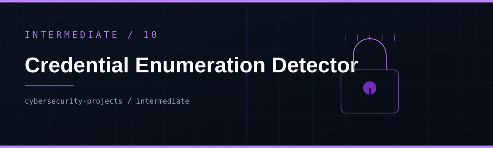
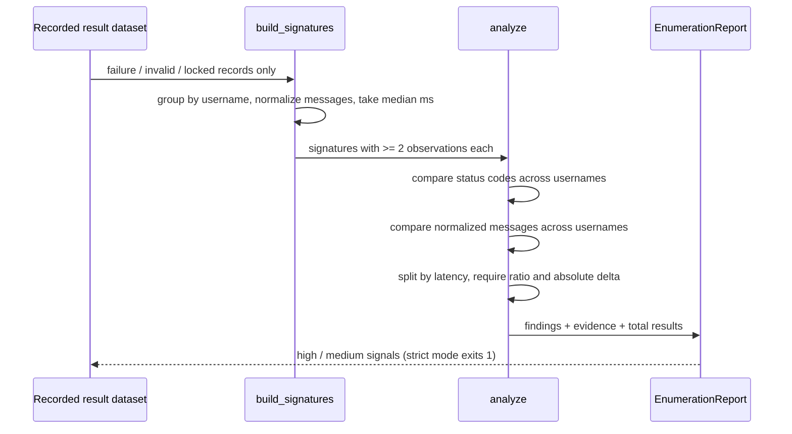

<div align="center">
  
</div>

<br />

<div align="center">

# 🕵️ Credential Enumeration Detector


> **The leak is in the response, not the password.** Compare *failed* logins across usernames and a status code, message, or timing difference becomes evidence an auditor can act on.

</div>

---

## 🎯 What it does

It ingests a recorded JSON dataset of login outcomes and looks for three observable leaks: different HTTP status codes, different normalized error messages, and a slow/fast split in failure latency. Findings include the usernames and values on each side of the difference, so a team can fix the endpoint rather than guess.

**Upstream synopsis was offensive (credential enumeration). This project is a defensive substitution:** it detects enumeration-observable behavior in an already-recorded dataset of login results. **It does not send login requests, guess passwords, or contact any service.**

## 🧠 How it works



| Kind | Severity | Meaning |
| --- | --- | --- |
| `status_code_differential` | high | Failed attempts return different HTTP codes for different usernames. |
| `message_differential` | high | Failed attempts return different normalized messages for different usernames. |
| `timing_differential` | medium | Failure response times form a slow/fast split beyond the configured ratio and absolute delta. |

Successful logins are deliberately excluded: comparing a success with a failure would always produce a difference. A username needs at least two observations by default, and at least two usernames are required before comparisons are made. Medians resist jitter, and the absolute-delta check suppresses tiny but proportionally large timing splits.

## 🚀 Quick start

```powershell
python credential_enumeration_detector.py results.json
python credential_enumeration_detector.py results.json --json --strict
```

Input is a JSON list of records — **no passwords or other secrets belong in this dataset**:

```json
[
  {"username": "alice", "outcome": "failure", "status_code": 401,
   "message": "Invalid credentials", "duration_ms": 48.5},
  {"username": "bob", "outcome": "failure", "status_code": 403,
   "message": "Account locked", "duration_ms": 210.0}
]
```

### Real output

Captured by running the CLI against a synthetic 12-record dataset written to a temporary file:

```text
$ python credential_enumeration_detector.py "$env:TEMP\readme-10-results.json"
status_code_differential (high): failed logins return different status codes for different usernames
  - alice=[401]
  - bob=[403]
  - carol=[401]
  - dave=[403]
message_differential (high): failed logins return different messages for different usernames
  - alice=['invalid credentials']
  - bob=['account locked']
  - carol=['invalid credentials']
  - dave=['account locked']
timing_differential (medium): failure response times differ by 168.5 ms (4.62x)
  - fast=alice,carol
  - slow=bob,dave
3 signal(s) from 12 result(s)
```

With `--strict`, the same analysis exits with code 1 when any signal is found — useful for a compliance gate.

## 📂 Project structure

```text
10-credential-enumeration-detector/
├── assets/hero.svg                            # generated visual identity
├── credential_enumeration_detector.py         # signatures, signals, CLI
├── learn/README.md                            # why failures only, median over mean
└── tests/test_credential_enumeration_detector.py  # 14 deterministic tests
```

## 🔍 Why it matters

- **Uniform failures are a security control.** A distinct code or message for an existing account turns a login form into a directory lookup.
- **Timing is a side channel.** Returning early for unknown users leaks account existence even when the error text is identical.
- **Evidence beats alarm.** Printing the per-user codes, messages, and latency split makes remediation concrete and reviewable.

## 🧪 Tests

```powershell
python -m unittest discover -s tests -v
```

14 deterministic tests using synthetic result records.

## 📚 Learn more

Read [the concept notes](learn/README.md) for the underlying enumeration leak, why only failures are compared, why medians beat means, and which uniform-response patterns remove the signal.

## 🛡️ Safety

Pure offline analysis of caller-supplied data. There is no HTTP client, no socket usage, and no credential handling.

---

<div align="center">
  <sub>Part of <b>cybersecurity-projects</b> · Intermediate tier · Offensive synopsis, original defensive substitution.</sub>
</div>
