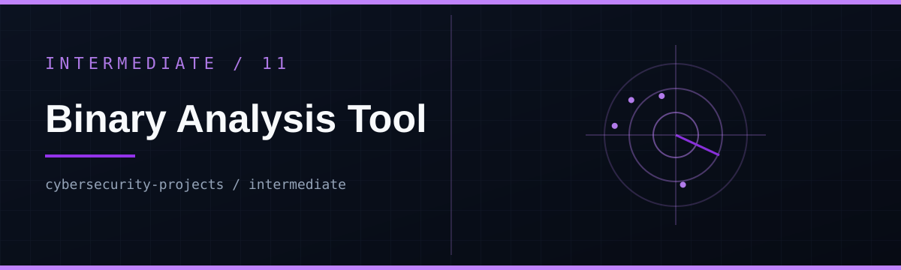
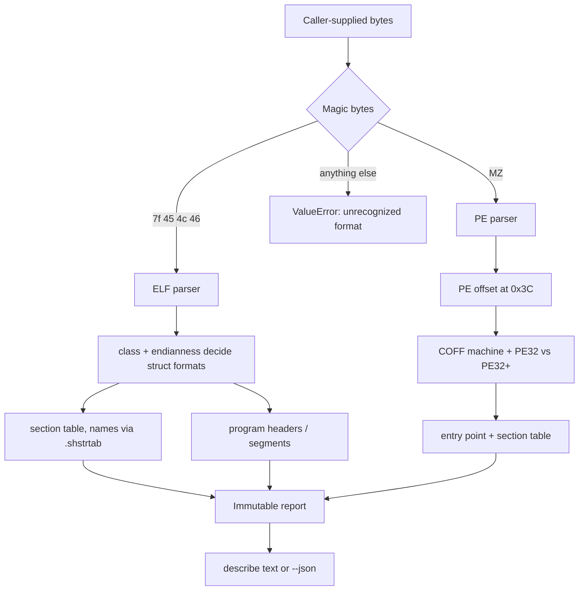

<div align="center">
  
</div>

<br />

<div align="center">

# 🔬 Binary Analysis Tool


> **Read the header, never the payload.** Magic bytes route an ELF or PE file into a `struct`-based parser that reports machines, sections, and segments without executing anything.

</div>

---

## 🎯 What it does

It inspects the metadata tables of ELF and PE files: class, byte order, machine, section names, program headers, entry point. Unknown machine codes are reported as `unknown (0x…)` instead of guessed, and truncated or malformed headers raise `ValueError`.

**Upstream language: Rust. This implementation is a Python substitution** using `struct` from the standard library. It performs the same header-level inspection — ELF class/machine/sections/segments or PE type/machine/sections — without a loader or native dependencies.

Library usage is bytes-in, report-out:

```python
from binary_analysis_tool import analyze, describe

print(describe(analyze(data)))
```

## 🧠 How it works



Both parsers check lengths before every `struct.unpack_from`, so a truncated fixture fails cleanly rather than reading adjacent bytes. Section names come from a string table via a second indirection.

## 🚀 Quick start

```powershell
python binary_analysis_tool.py sample.bin
python binary_analysis_tool.py sample.bin --json
```

The CLI takes one local file path. For a bytes-in library call, use `analyze(data)` directly.

### Real output

Captured by running the CLI on synthetic ELF64 and PE32+ fixtures assembled with `struct.pack` and written to temporary files:

```text
$ python binary_analysis_tool.py "$env:TEMP\readme-11-elf.bin"
format: ELF
type: ELF64
machine: x86-64 (0x3e)
endianness: little
sections (3):
  section_0 null addr=0x0 size=0x0
  .text progbits addr=0x1000 size=0x20
  .shstrtab strtab addr=0x0 size=0x11
segments (1):
  load vaddr=0x1000 filesz=0x100

$ python binary_analysis_tool.py "$env:TEMP\readme-11-pe.bin" --json
{
  "pe_type": "PE32+",
  "machine": "x86-64",
  "machine_code": 34404,
  "entry_point": 4096,
  "sections": [
    {
      "name": ".text",
      "virtual_size": 32,
      "virtual_address": 4096,
      "raw_size": 512,
      "raw_offset": 512,
      "characteristics": 1610612768
    },
    {
      "name": ".rdata",
      "virtual_size": 32,
      "virtual_address": 8192,
      "raw_size": 512,
      "raw_offset": 1024,
      "characteristics": 1610612768
    }
  ]
}
```

## 📂 Project structure

```text
11-binary-analysis-tool/
├── assets/hero.svg                    # generated visual identity
├── binary_analysis_tool.py            # ELF/PE parsers + describe + CLI
├── learn/README.md                    # magic numbers, class, endianness, tables
└── tests/test_binary_analysis_tool.py # 15 deterministic tests
```

## 🔍 Why it matters

- **Format identification is triage.** Knowing ELF64 vs PE32+ and the target machine narrows what a sample could even run on.
- **Tables tell a story.** Section permissions and segment layout are the first clues in static review — without unpacking or running a payload.
- **Deterministic failures.** Rejecting truncated headers keeps a corrupt fixture from being misread as a valid report.

## 🧪 Tests

```powershell
python -m unittest discover -s tests -v
```

15 deterministic tests. All fixtures are synthetic byte strings assembled with `struct.pack` in the test file; no sample malware is included.

## 📚 Learn more

Read [the concept notes](learn/README.md) for magic numbers, class and endianness, the difference between linker-view sections and loader-view segments, and why hand-built fixtures are safer than shipping real binaries.

## 🛡️ Safety

Pure header parsing. There are no subprocess calls, no dynamic loading, and no network access. Only bytes are inspected — nothing is mapped, loaded, or executed.

---

<div align="center">
  <sub>Part of <b>cybersecurity-projects</b> · Intermediate tier · Rust synopsis, original Python substitution.</sub>
</div>
