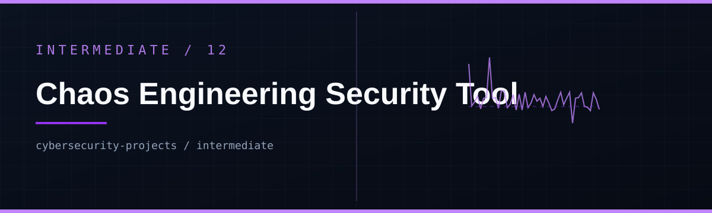
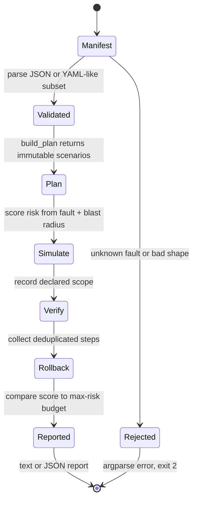

<div align="center">
  
</div>

<br />

<div align="center">

# 🌀 Chaos Engineering Security Tool


> **Plan the failure, never cause it.** A manifest becomes a risk-scored timeline with an explicit rollback checklist — and nothing in the plan is executable.

</div>

---

## 🎯 What it does

It turns a declarative manifest into a reviewable simulation: a per-scenario risk score, a `plan → simulate → verify → rollback` timeline, a blast-radius statement, a deduplicated rollback plan, and warnings when a scenario breaks the risk budget or lacks rollback steps.

**Upstream language: Go. This implementation is a Python substitution** using only the standard library. It preserves the planning and reporting behavior while replacing Go's concurrency and CLI stack with immutable dataclasses and a simple `argparse` interface.

**Safety boundary:** the tool plans and *simulates* security-focused fault scenarios. **Disruption is never executed.** There is no subprocess, socket, or service client in the implementation.

## 🧠 How it works



Manifests may be JSON or a small YAML-like subset (indented mappings, `- ` list items, inline `[a, b]` lists and `{key: value}` maps, quoted strings, and `#` comments). PyYAML is not required.

Supported fault types are an explicit allowlist: `auth_delay`, `tls_config_regression`, `firewall_rule_misconfiguration`, `token_expiry_skew`, `rate_limit_disabled`, `logging_drop`. Unknown faults are rejected — a manifest is data, not code.

## 🚀 Quick start

```powershell
python chaos_engineering_security_tool.py plan.yaml
python chaos_engineering_security_tool.py plan.json --json --max-risk 70
```

```yaml
scenarios:
  - id: tls-regression
    target: staging-api
    fault: tls_config_regression
    duration_seconds: 90
    blast_radius:
      services: [gateway, auth]
      users: 40
      data_sensitivity: high
    rollback:
      - restore_config
      - restart_gateway
```

The risk score is a transparent sum of fault severity, service count, user count, data sensitivity, and duration (capped at 100). `--max-risk` sets the budget; the CLI returns exit code 1 when a scenario exceeds it.

### Real output

Captured by running the CLI against a synthetic two-scenario YAML plan written to a temporary file:

```text
$ python chaos_engineering_security_tool.py "$env:TEMP\readme-12-plan.yaml"
tls-regression: tls_config_regression on staging-api [enabled] risk=69
log-drop: logging_drop on staging-worker [enabled] risk=69
9 simulated event(s), 3 rollback step(s)

$ python chaos_engineering_security_tool.py "$env:TEMP\readme-12-plan.yaml" --max-risk 60
tls-regression: tls_config_regression on staging-api [enabled] risk=69
log-drop: logging_drop on staging-worker [enabled] risk=69
WARNING tls-regression: risk 69 exceeds budget 60
WARNING log-drop: risk 69 exceeds budget 60
9 simulated event(s), 3 rollback step(s)
exit=1
```

## 📂 Project structure

```text
12-chaos-engineering-security-tool/
├── assets/hero.svg                             # generated visual identity
├── chaos_engineering_security_tool.py          # manifest reader, planner, simulator, CLI
├── learn/README.md                             # blast radius, risk scoring, rollback
└── tests/test_chaos_engineering_security_tool.py  # 17 deterministic tests
```

## 🔍 Why it matters

- **Scope before action.** Declared services, users, regions, and data sensitivity make blast radius a number a reviewer can challenge.
- **Rollback is a first-class field.** A scenario with no rollback steps gets an explicit warning and a missing entry in the checklist.
- **Data cannot become code.** Allowlisted fault names mean a typo or hostile manifest never turns into a command.

## 🧪 Tests

```powershell
python -m unittest discover -s tests -v
```

17 deterministic tests with synthetic manifests.

## 📚 Learn more

Read [the concept notes](learn/README.md) for why simulation comes first, how the risk score is composed, why fault names are allowlisted, and how to treat rollback as a reviewable artifact.

## 🛡️ Safety

Planning and simulation only. No scenario has an executor, and no command derived from a manifest is ever run.

---

<div align="center">
  <sub>Part of <b>cybersecurity-projects</b> · Intermediate tier · Go synopsis, original Python substitution.</sub>
</div>
