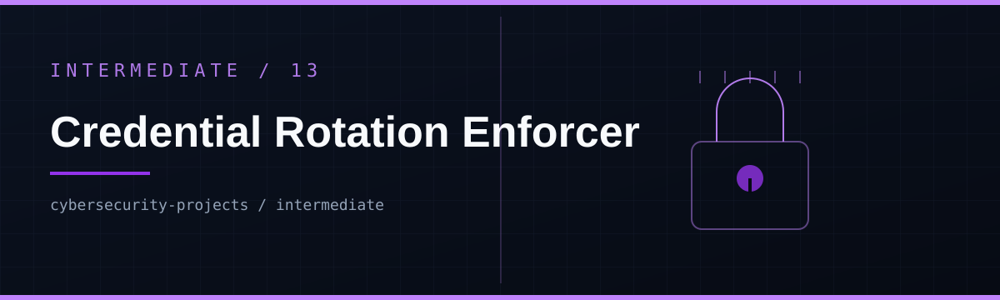
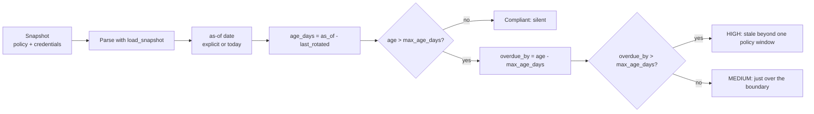

<div align="center">
  
</div>

<br />

<div align="center">

# 🔑 Credential Rotation Enforcer


> **Age is the policy.** Metadata only — service, owner, rotation date — checked against a maximum age, with a strict boundary and an explicit "as of" day.

</div>

---

## 🎯 What it does

It reads a JSON inventory of credentials and reports entries whose age exceeds the rotation policy, with owner, whole-day age, days overdue, and a severity of `medium` or `high`. A one-off `--max-age` override supports what-if checks before changing the written policy.

Crystal upstream, replaced here with a Python policy checker. It reads a JSON snapshot of credentials and reports entries older than the configured maximum age. **No real credential store, vault, directory, or network endpoint is accessed.**

## 🧠 How it works



- Age is whole days between `last_rotated` and `--as-of`. Passing `--as-of` makes runs deterministic.
- A credential is overdue only when `age_days > max_age_days`; the boundary is not overdue.
- Severity is `medium` when overdue by up to one policy window and `high` beyond that.
- `--max-age` overrides the snapshot policy for a one-off what-if check.

## 🚀 Quick start

```powershell
python rotation.py snapshot.json --as-of 2026-11-20
python rotation.py snapshot.json --as-of 2026-11-20 --max-age 30
```

```json
{
  "policy": {"max_age_days": 90},
  "credentials": [
    {"service": "example-api", "last_rotated": "2026-01-10", "owner": "team-a"},
    {"service": "example-db", "last_rotated": "2026-10-01", "owner": "team-b"}
  ]
}
```

### Real output

Captured by running the CLI against a synthetic four-credential snapshot written to a temporary file:

```text
$ python rotation.py "$env:TEMP\readme-13-snapshot.json" --as-of 2026-11-20
[HIGH  ] example-api owner=team-a age=314d overdue_by=224d
[MEDIUM] example-ci owner=team-c age=92d overdue_by=2d
2 overdue credential(s) as of 2026-11-20

$ python rotation.py "$env:TEMP\readme-13-snapshot.json" --as-of 2026-11-20 --max-age 30
[HIGH  ] example-api owner=team-a age=314d overdue_by=284d
[MEDIUM] example-db owner=team-b age=50d overdue_by=20d
[HIGH  ] example-ci owner=team-c age=92d overdue_by=62d
3 overdue credential(s) as of 2026-11-20
```

## 📂 Project structure

```text
13-credential-rotation-enforcer/
├── assets/hero.svg            # generated visual identity
├── rotation.py                # age policy, findings, CLI
├── learn/README.md            # why age, boundaries, escalation
└── tests/test_rotation.py     # 9 deterministic tests
```

## 🔍 Why it matters

- **Rotation becomes measurable.** A maximum age turns "rotate regularly" into a rule that can be checked and reported.
- **Boundaries matter.** `age > max_age_days` avoids noisy violations on the exact policy day.
- **Escalation focuses attention.** Escalating past one policy window helps owners triage the worst stale secrets first.

## 🧪 Tests

```powershell
python -m unittest discover -s tests -v
```

9 deterministic tests. Standard library only. All credentials in fixtures are synthetic service names and dates; no secret values are present.

## 📚 Learn more

Read [the concept notes](learn/README.md) for why rotation age is the right unit, why an explicit `as_of` beats the system clock in a pure function, and how boundary conditions shape compliance reports.

## 🛡️ Safety

An inventory checker consumes metadata only: service name, owner, and rotation date. This implementation performs no I/O beyond reading the caller's snapshot file.

---

<div align="center">
  <sub>Part of <b>cybersecurity-projects</b> · Intermediate tier · Crystal synopsis, original Python substitution.</sub>
</div>
