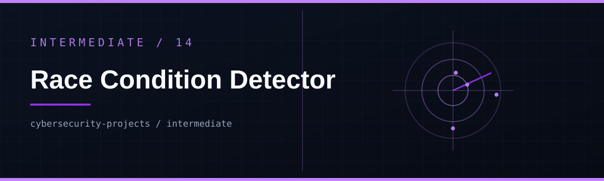
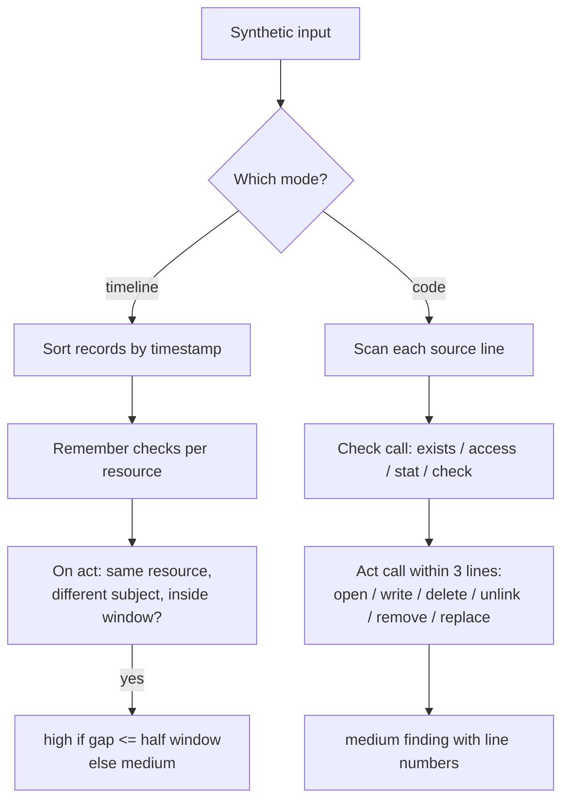

<div align="center">
  
</div>

<br />

<div align="center">

# ⏱️ Race Condition Detector


> **The gap between check and use is the finding.** Two modes — event timelines and source snippets — surface TOCTOU-shaped risk without ever scheduling a race.

</div>

---

## 🎯 What it does

It classifies data the caller supplies in two ways: an access-log timeline where one subject checks a resource and a *different* subject acts on it soon after, and source snippets where a check call is followed within three lines by an act call. Findings carry a severity, the resource or filename, and a short explanation of the gap.

The upstream synopsis asked for a race-condition exploiter. That capability is intentionally not implemented. This project is a **defensive substitution**: it detects check-then-act (TOCTOU) risk in synthetic access logs and code snippets. It does not trigger, time, or exploit any race.

## 🧠 How it works



- **Timeline:** an `act` on the same resource by a *different* subject within the window after a `check` is reported. Smaller gaps score `high`; larger gaps score `medium`.
- **Code:** a check call followed within three lines by an act call is reported as `medium`.

The code scan is a heuristic pattern match, not data-flow analysis — findings are leads for a human reviewer.

## 🚀 Quick start

```powershell
python race_detector.py timeline events.json --window 5
python race_detector.py code sources.json
```

`events.json` is a list of records with `timestamp` (ISO-8601), `subject`, `resource`, and `phase` (`check` or `act`):

```json
[
  {"timestamp": "2026-01-01T00:00:00", "subject": "alice", "resource": "/tmp/report", "phase": "check"},
  {"timestamp": "2026-01-01T00:00:01", "subject": "bob", "resource": "/tmp/report", "phase": "act"}
]
```

`sources.json` maps a label to source text: `{"app.py": "if os.path.exists(p):\n    open(p)\n"}`.

### Real output

Captured by running both subcommands against synthetic JSON fixtures written to temporary files:

```text
$ python race_detector.py timeline "$env:TEMP\readme-14-events.json" --window 5
[HIGH  ] timeline-toctou /tmp/report: check by alice followed by act after 1s
[MEDIUM] timeline-toctou /tmp/keys: check by erin followed by act after 4s
2 potential TOCTOU finding(s)

$ python race_detector.py code "$env:TEMP\readme-14-sources.json"
[MEDIUM] code-toctou app.py: check at line 1 followed by act at line 2
[MEDIUM] code-toctou worker.py: check at line 1 followed by act at line 3
2 potential TOCTOU finding(s)
```

The same-subject act and the check outside the 5-second window are correctly absent from the timeline findings.

## 📂 Project structure

```text
14-race-condition-detector/
├── assets/hero.svg             # generated visual identity
├── race_detector.py            # timeline + code analyzers, CLI subcommands
├── learn/README.md             # TOCTOU, why the window matters, defensive patterns
└── tests/test_race_detector.py # 10 deterministic tests
```

## 🔍 Why it matters

- **TOCTOU is a timing bug.** Two actors touching one resource make the window measurable in an event log.
- **Different subjects are the interesting case.** A same-subject check-then-act is normal control flow; a cross-subject one breaks the assumption behind the check.
- **Code review gets a starting point.** Line-numbered check/act pairs point a reviewer at atomic-operation or re-validation fixes.

## 🧪 Tests

```powershell
python -m unittest discover -s tests -v
```

10 deterministic tests. Standard library only; every fixture is synthetic. This is a heuristic review aid, not proof that a vulnerability exists.

## 📚 Learn more

Read [the concept notes](learn/README.md) for what a race is, why the check-to-use window matters, defensive patterns such as atomic operations and re-validation, and the analyzer's deliberate scope.

## 🛡️ Safety

The analyzer only classifies data you provide. It performs no scheduling, no synchronisation primitives, and no interaction with real files or services.

---

<div align="center">
  <sub>Part of <b>cybersecurity-projects</b> · Intermediate tier · Exploiter synopsis, original defensive substitution.</sub>
</div>
