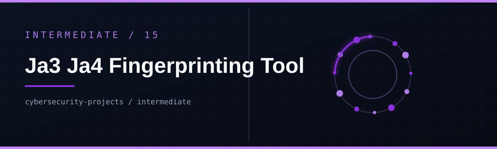
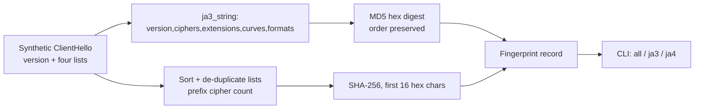

<div align="center">
  
</div>

<br />

<div align="center">

# 🆔 JA3/JA4 TLS Fingerprinting Tool


> **Field order is identity.** One synthetic ClientHello becomes an order-sensitive JA3 digest and an order-insensitive JA4-like teaching digest — no packets involved.

</div>

---

## 🎯 What it does

It builds the canonical JA3 string from five numeric fields, hashes it with MD5, and also computes a simplified JA4-like digest with SHA-256. Running both side by side makes the design difference visible: reorder or duplicate a cipher and JA3 changes while the JA4-like value stays the same.

Rust upstream, replaced here with a standard-library Python implementation. It computes JA3-style hashes from synthetic ClientHello field lists. **There is no live TLS capture, no socket, and no handshake.**

## 🧠 How it works



- **JA3:** joins `version`, and the `-`-joined cipher, extension, curve, and format lists with commas, then takes the MD5 hex digest. Order matters, exactly as in the JA3 specification.
- **JA4-like:** a simplified teaching variant. Lists are sorted and de-duplicated, the cipher count is prefixed, and the first 16 hex characters of SHA-256 are used. It is **not** wire-compatible with real JA4.
- MD5 is used only as the historical JA3 hash primitive; it is not used for any security decision here.

## 🚀 Quick start

```powershell
python fingerprint.py hellos.json
python fingerprint.py hellos.json --algo ja3
```

Snapshot format (a JSON list):

```json
[
  {
    "version": 771,
    "ciphers": [49199, 49195, 52392],
    "extensions": [0, 10, 23],
    "curves": [23, 24],
    "formats": [0]
  }
]
```

### Real output

Captured by running the CLI against two synthetic hellos written to a temporary file. The second record contains the same ciphers in a different order plus a duplicate:

```text
$ python fingerprint.py "$env:TEMP\readme-15-hellos.json"
0 ja3=434877ef4df9083c0da5e5cffd246ad9 ja4_like=c27ef271babfb1e0
1 ja3=926589b676cb452598de51dee3a91d46 ja4_like=c27ef271babfb1e0
2 fingerprint(s) computed

$ python fingerprint.py "$env:TEMP\readme-15-hellos.json" --algo ja3
0 ja3=434877ef4df9083c0da5e5cffd246ad9
1 ja3=926589b676cb452598de51dee3a91d46
2 fingerprint(s) computed

$ python fingerprint.py "$env:TEMP\readme-15-hellos.json" --algo ja4
0 ja4_like=c27ef271babfb1e0
1 ja4_like=c27ef271babfb1e0
2 fingerprint(s) computed
```

The differing JA3 values and identical JA4-like values demonstrate exactly what each construction preserves.

## 📂 Project structure

```text
15-ja3-ja4-fingerprinting-tool/
├── assets/hero.svg          # generated visual identity
├── fingerprint.py           # JA3 string, both digests, CLI
├── learn/README.md          # JA3 construction, JA4 variation, GREASE
└── tests/test_fingerprint.py # 9 deterministic tests
```

## 🔍 Why it matters

- **Order is a feature.** JA3 intentionally distinguishes clients that send the same suites in a different order.
- **Normalization answers a different question.** Sorting and de-duplicating suppresses ordering noise when that is what a study wants.
- **Know the limits.** The JA4-like value is a teaching aid, not an interoperable implementation; MD5 here is a specification artifact, not a security choice.

## 🧪 Tests

```powershell
python -m unittest discover -s tests -v
```

9 deterministic tests. Standard library only. All values are synthetic integers, not observed traffic.

## 📚 Learn more

Read [the concept notes](learn/README.md) for the five JA3 fields, why cipher order is preserved, how the simplified JA4 variant differs, and what GREASE means for real pipelines.

## 🛡️ Safety

Fingerprinting here operates only on numbers the caller supplies. No capture, interception, or network access is involved, and the hashes are not used to identify or track real people.

---

<div align="center">
  <sub>Part of <b>cybersecurity-projects</b> · Intermediate tier · Rust synopsis, original Python substitution.</sub>
</div>
