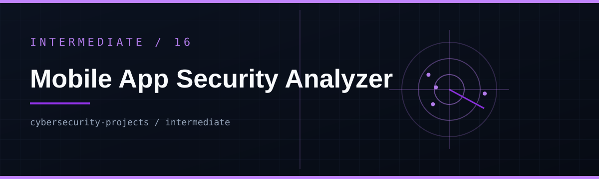
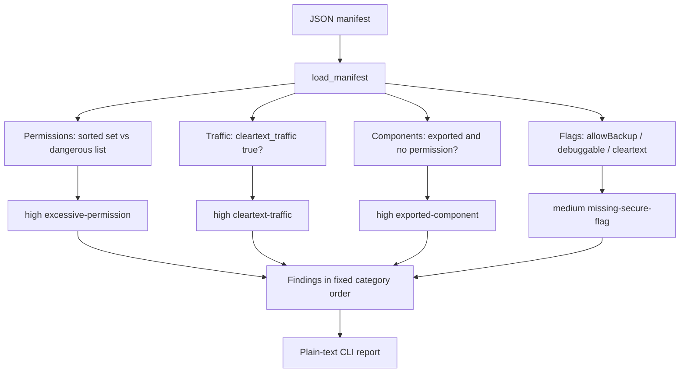

<div align="center">
  
</div>

<br />

<div align="center">

# 📱 Mobile App Security Analyzer


> **The manifest is the attack-surface map.** Four independent checks turn declared permissions, traffic settings, components, and flags into a stable, reviewable finding list.

</div>

---

## 🎯 What it does

It analyzes a synthetic Android/iOS manifest JSON for four classes of misconfiguration and prints findings in a stable order: permissions, traffic, components, then secure flags. An exported component with its own permission is accepted; a missing secure flag is treated as a finding because platform defaults are not always the hardened choice.

Python-only project. It analyzes a synthetic Android/iOS manifest JSON for excessive permissions, cleartext traffic, exported components, and missing secure flags. **No APK/IPA parsing, device access, or network activity is involved.**

## 🧠 How it works



| Category | Severity | Trigger |
| --- | --- | --- |
| `excessive-permission` | high | A dangerous permission such as `READ_SMS` or `ACCESS_FINE_LOCATION` is requested. |
| `cleartext-traffic` | high | `cleartext_traffic` is true. |
| `exported-component` | high | A component is exported without a permission guard. |
| `missing-secure-flag` | medium | A secure flag is absent or set to an insecure value. |

The input is a simplified, platform-neutral projection — the analyzer does not unpack a real application bundle.

## 🚀 Quick start

```powershell
python mobile_analyzer.py manifest.json
```

```json
{
  "platform": "android",
  "package": "com.example.demo",
  "permissions": ["INTERNET", "READ_SMS", "ACCESS_FINE_LOCATION"],
  "cleartext_traffic": true,
  "components": [
    {"name": "ExportActivity", "kind": "activity", "exported": true},
    {"name": "InternalService", "kind": "service", "exported": false}
  ],
  "secure_flags": {
    "allowBackup": false,
    "debuggable": false,
    "cleartextTrafficPermitted": false
  }
}
```

### Real output

Captured by running the CLI against a synthetic manifest written to a temporary file. It includes a guarded exported receiver that is correctly *not* flagged:

```text
$ python mobile_analyzer.py "$env:TEMP\readme-16-manifest.json"
[HIGH  ] excessive-permission: com.example.demo requests ACCESS_FINE_LOCATION
[HIGH  ] excessive-permission: com.example.demo requests CAMERA
[HIGH  ] excessive-permission: com.example.demo requests READ_SMS
[HIGH  ] cleartext-traffic: com.example.demo permits cleartext network traffic
[HIGH  ] exported-component: activity ExportActivity is exported without a permission
[MEDIUM] missing-secure-flag: allowBackup should be False, found True
[MEDIUM] missing-secure-flag: cleartextTrafficPermitted should be False, found None
7 finding(s) for com.example.demo (android)
```

## 📂 Project structure

```text
16-mobile-app-security-analyzer/
├── assets/hero.svg              # generated visual identity
├── mobile_analyzer.py           # manifest model, four checks, CLI
├── learn/README.md              # manifest risk indicators and review scope
└── tests/test_mobile_analyzer.py # 9 deterministic tests
```

## 🔍 Why it matters

- **Over-privilege is visible early.** SMS, location, contacts, and audio permissions deserve a feature justification before release.
- **Cleartext traffic is high severity.** Unencrypted HTTP permits eavesdropping and tampering on any path.
- **Exported components need guards.** Without their own permission check, they can bypass the app's UI controls.
- **Explicit secure flags beat defaults.** Missing `allowBackup` or `debuggable` values are findings, not assumed-safe states.

## 🧪 Tests

```powershell
python -m unittest discover -s tests -v
```

9 deterministic tests. Standard library only. All package names and component names in fixtures are synthetic.

## 📚 Learn more

Read [the concept notes](learn/README.md) for how manifests map to attack surface, why each check matters, and which parts of a real review (code analysis, dependencies, runtime testing) sit outside this tool.

## 🛡️ Safety

The analyzer works on a simplified JSON projection of a manifest. It does not parse real APK/IPA archives, talk to a device, or access an app store; real reviews also need code analysis, dependency checks, and runtime testing.

---

<div align="center">
  <sub>Part of <b>cybersecurity-projects</b> · Intermediate tier · Python-only project, original implementation.</sub>
</div>
