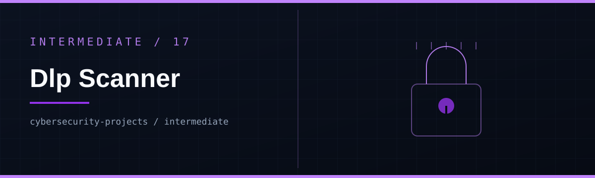
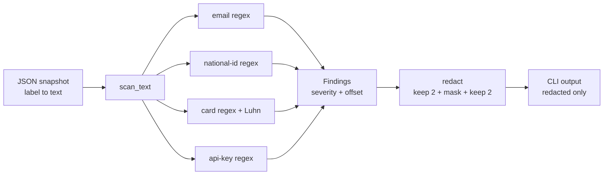

<div align="center">
  
</div>

<br />

<div align="center">

# 🔎 DLP Scanner


> **Spot it, mask it, never print it.** A text-snapshot scanner that surfaces PII and secret-shaped strings — then redacts every match before it reaches the terminal.

</div>

---

## 🎯 What it does

It reads a JSON object of `{label: text}` snapshots, sweeps each string with four heuristic patterns, and emits one `Finding` per hit with a kind, severity, and character offset. Payment-card candidates are additionally checked with the Luhn checksum before they are reported.

All test data is synthetic; no real personal data, credential store, or network service is used. Pattern matching is heuristic: a hit is a lead for review, not proof of a real secret.

| Kind | Severity | Detection |
| --- | --- | --- |
| `email` | low | Email-shaped address (`.test` fixtures). |
| `national-id-like` | high | Three-two-four digit group shape. |
| `credit-card-like` | high | 13–19 digit candidate that passes the Luhn checksum. |
| `api-key` | high | Synthetic AWS/GitHub/OpenAI-style key prefixes. |

## 🧠 How it works



A `Finding` holds the raw match for programmatic checks, but the CLI prints only the redacted form. Redaction keeps two leading and two trailing characters and masks the rest with `*`.

## 🚀 Quick start

```powershell
python dlp_scanner.py snapshots.json
```

Example `snapshots.json`:

```json
{
  "note.txt": "Contact user@example.test or card 4111 1111 1111 1111.",
  "clean.txt": "nothing sensitive here"
}
```

### Real output

```text
$ python dlp_scanner.py snapshots.json
[LOW   ] note.txt: email -> us*************st
[HIGH  ] note.txt: credit-card-like -> 41***************11
[HIGH  ] note.txt: national-id-like -> 12*******89
[HIGH  ] note.txt: api-key -> AK****************OP
4 finding(s)
```

## 📂 Project structure

```text
17-dlp-scanner/
├── assets/hero.svg           # generated visual identity
├── dlp_scanner.py            # patterns + Luhn + redaction + CLI
├── learn/README.md           # the concepts behind DLP heuristics
└── tests/test_dlp_scanner.py # 11 deterministic tests
```

## 🔍 Why it matters

- **The scanner must not become a second leak.** Printing raw matches in a report defeats the purpose of DLP; redaction-first output avoids that.
- **Checksums cut noise.** A Luhn check turns a broad digit regex into a much more credible card candidate.
- **Severity enables triage.** Low-confidence shape matches and high-impact credential patterns are separated at the source.
- **Heuristics are leads.** Findings are inputs to human review, never automatic accusations.

## 🧪 Tests

```powershell
python -m unittest discover -s tests -v
```

11 tests covering email and ID detection, valid versus invalid card numbers, API key prefixes, clean text, Luhn edge cases, redaction, finding order and immutability, plus the CLI's redacted-only output.

## 📚 Learn more

Read [the concept notes](learn/README.md) for detection heuristics, checksum validation, and why redaction belongs at the output boundary.

---

<div align="center">
  <sub>Part of <b>cybersecurity-projects</b> · Intermediate tier · Built from a synopsis, original implementation.</sub>
</div>
