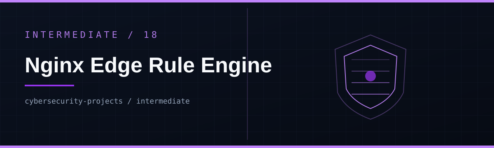
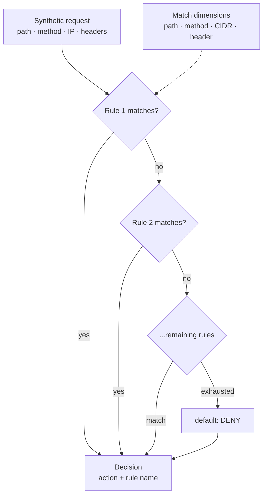

<div align="center">
  
</div>

<br />

<div align="center">

# 🚦 Nginx Edge Rule Engine


> **One request, one verdict.** nginx-style access rules, evaluated top to bottom by a standard-library Python engine — no server, no socket, no guesswork.

</div>

---

## 🎯 What it does

Lua/Nginx upstream, replaced here with a standard-library Python rule evaluator. It reads a JSON list of rules and evaluates one synthetic request (path, method, client IP, headers). The first matching rule returns `ALLOW` or `DENY` along with the name of the rule that decided it.

No server is started and no network call is made. IP addresses in fixtures come from documentation ranges.

- Rules are evaluated top to bottom; the first match decides.
- `path` supports `"*"`, a trailing-wildcard prefix (`"/api/*"`), or an exact string.
- `method` is `"any"` or an explicit method (case-insensitive).
- `cidr` is checked with `ipaddress`; header names are case-insensitive, values are exact.
- No match means `deny` with rule name `default`. This is stricter than nginx's implicit allow, and is intentional for a lab evaluator.

## 🧠 How it works



Each rule combines four independent dimensions. All must agree before a rule fires, which makes a single overly broad rule much less likely to decide by accident.

## 🚀 Quick start

```powershell
python edge_rules.py rules.json --path /api/admin --method POST --ip 10.1.2.3 --header X-Role=admin
```

Example `rules.json`:

```json
[
  {"name": "public", "action": "allow", "path": "/public/*", "method": "GET"},
  {"name": "admin", "action": "allow", "path": "/api/admin", "method": "POST",
   "cidr": "10.0.0.0/8", "header": ["X-Role", "admin"]},
  {"name": "deny-admin", "action": "deny", "path": "/api/admin"},
  {"name": "deny-all", "action": "deny"}
]
```

### Real output

```text
$ python edge_rules.py rules.json --path /api/admin --method POST --ip 10.1.2.3 --header X-Role=admin
ALLOW (admin)

$ python edge_rules.py rules.json --path /api/admin --method POST --ip 203.0.113.5 --header X-Role=admin
DENY (deny-admin)

$ python edge_rules.py rules.json --path /public/logo --method GET --ip 203.0.113.5
ALLOW (public)
```

## 📂 Project structure

```text
18-nginx-edge-rule-engine/
├── assets/hero.svg           # generated visual identity
├── edge_rules.py             # rule model + matcher + CLI
├── learn/README.md           # the concepts behind edge access rules
└── tests/test_edge_rules.py  # 9 deterministic tests
```

## 🔍 Why it matters

- **Order is policy.** A wide `allow` above a narrow `deny` silently swallows the deny; the returned rule name makes that visible.
- **Fail closed.** Defaulting to `deny` turns a missing rule into a safe outcome rather than an unintended permit.
- **Layered conditions.** Combining path, method, CIDR, and header keeps privileged routes behind more than one check.
- **Portable teaching model.** The same first-match semantics transfer directly to real nginx and edge configurations.

## 🧪 Tests

```powershell
python -m unittest discover -s tests -v
```

9 tests covering prefix and exact paths, CIDR and header matching, fall-through to deny rules, first-match precedence, default and configurable defaults, loaders, and the CLI.

## 📚 Learn more

Read [the concept notes](learn/README.md) for first-match access control, wildcard paths, and why a lab evaluator should default to deny.

---

<div align="center">
  <sub>Part of <b>cybersecurity-projects</b> · Intermediate tier · Built from a synopsis, original implementation.</sub>
</div>
