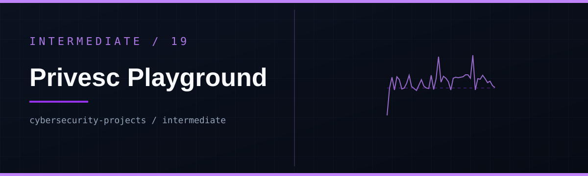
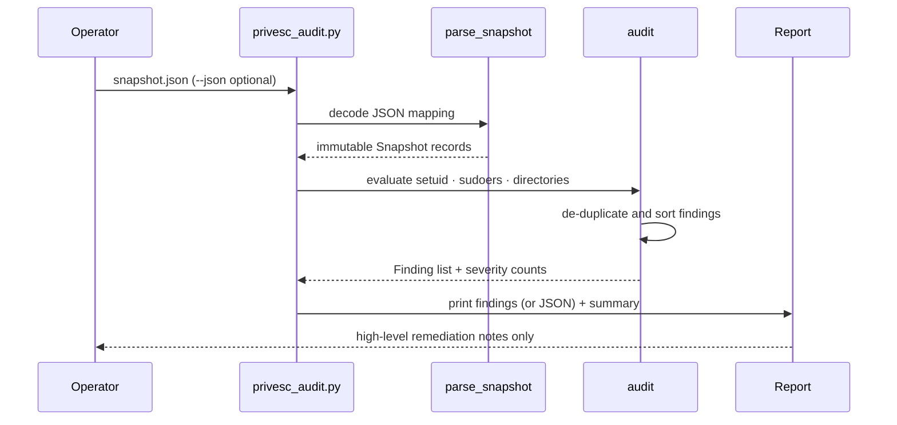

<div align="center">
  
</div>

<br />

<div align="center">

# 🔬 Privilege Escalation Indicator Auditor


> **Read the snapshot, not the system.** A defensive auditor that turns setuid bits, sudoers lines, and writable directories into prioritized hardening notes.

</div>

---

## 🎯 What it does

The upstream synopsis is an offensive "Privesc Playground". This build is a **defensive substitution**: it reads a synthetic system snapshot and reports risky privilege paths. It does not provide exploitation steps, execute commands, or touch a live system. The auditor only reads the JSON file passed on the command line.

Modes are octal strings (or integers written as octal digits). Every finding includes a high-level remediation note. No exploit commands are produced.

| Check group | What it looks for |
| --- | --- |
| `SUID-001/002/003` | Root-owned world-executable setuid, writable setuid, non-root setuid owner. |
| `SUDO-001/002/003/004` | Broad passwordless rules, unrestricted command sets, wildcards, missing `env_reset`. |
| `DIR-001/002` | World-writable directories without a sticky bit, and setuid paths beneath writable directories. |

## 🧠 How it works



The chain is strictly one-way: text in, findings out. Nothing in the tool reaches beyond the supplied file.

## 🚀 Quick start

```powershell
python privesc_audit.py snapshot.json
python privesc_audit.py snapshot.json --json
```

Example `snapshot.json` (all paths and values are synthetic):

```json
{
  "suid_files": [
    {"path": "/opt/team/helper", "owner": "root", "mode": "4777"}
  ],
  "sudoers_lines": [
    "Defaults !env_reset",
    "alice ALL=(ALL) NOPASSWD: ALL"
  ],
  "world_writable_dirs": [
    {"path": "/var/tmp/shared", "mode": "0777"}
  ]
}
```

### Real output

```text
$ python privesc_audit.py snapshot.json
[HIGH  ] DIR-001 World-writable directory lacks the sticky bit: /var/tmp/shared mode=0777 -> Add the sticky bit or remove world-write permission.
[HIGH  ] SUDO-001 Passwordless rule grants all commands: alice ALL=(ALL) NOPASSWD: ALL -> Replace broad NOPASSWD rules with a narrow command allowlist.
[LOW   ] SUDO-004 Sudoers environment reset is not enforced: Defaults env_reset is absent or negated -> Keep env_reset enabled to limit inherited environment variables.
[HIGH  ] SUID-001 Root-owned setuid file is world executable: /opt/team/helper mode=4777 owner=root -> Confirm the file is required; otherwise remove the setuid bit.
[HIGH  ] SUID-002 Setuid file is group/world writable: /opt/team/helper mode=4777 owner=root -> Remove write bits from setuid files and review ownership.
summary: low=1, medium=0, high=4
```

## 📂 Project structure

```text
19-privesc-playground/
├── assets/hero.svg              # generated visual identity
├── privesc_audit.py             # snapshot model + checks + CLI
├── learn/README.md              # the concepts behind privilege indicators
└── tests/test_privesc_audit.py  # 7 deterministic tests
```

## 🔍 Why it matters

- **Visibility without exploitation.** Understanding which configurations are risky does not require demonstrating how to abuse them.
- **Sticky bits and setuid bits interact.** A privileged binary inside a writable directory is a different risk from either fact alone.
- **Environment hygiene counts.** A missing `env_reset` is a small line with a large blast radius.
- **Deterministic output.** Sorted, de-duplicated findings make the auditor usable in repeatable reviews.

## 🧪 Tests

```powershell
python -m unittest discover -s tests -v
```

7 deterministic tests covering octal parsing, clean snapshots, risky setuid and directory combinations, sudoers patterns, severity summaries, and JSON CLI output.

## 📚 Learn more

Read [the concept notes](learn/README.md) for setuid semantics, sudoers hygiene, and how defensive auditing differs from offensive testing.

---

<div align="center">
  <sub>Part of <b>cybersecurity-projects</b> · Intermediate tier · Built from a synopsis, original implementation.</sub>
</div>
