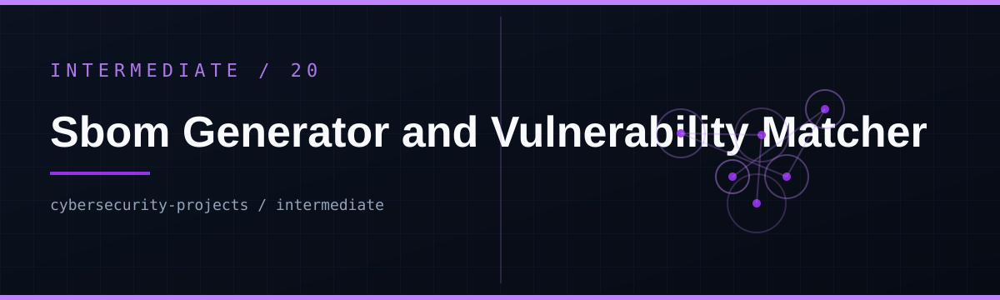
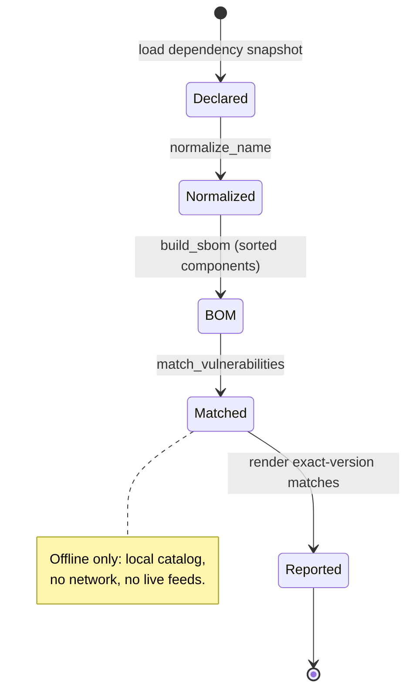

<div align="center">
  
</div>

<br />

<div align="center">

# 🧾 SBOM Generator & Vulnerability Matcher


> **Know what you ship.** A deterministic CycloneDX-like bill of materials, paired with an offline match against a local demo advisory catalog.

</div>

---

## 🎯 What it does

Upstream is Go; this build is a **Python substitution**. It reads a dependency snapshot, emits a minimal CycloneDX-like JSON document, and matches versions against a **local demo CVE catalog**. There are no network calls and no real vulnerability feeds.

- Package names are normalized (case and `-`/`_`/`.` separators) for comparison.
- Matching is **exact version equality** against `affected_versions`; no ranges or live lookups.
- Components and matches are sorted, so output is deterministic.
- With `--sbom`, the BOM is written to that file and a short match summary is printed. Without it, the BOM JSON is printed followed by the summary.
- All advisory IDs are synthetic `CVE-DEMO-*` values.

## 🧠 How it works



Each package becomes a purl-based component; each advisory is indexed by normalized package name. A match occurs only when the declared version is literally present in `affected_versions`.

## 🚀 Quick start

```powershell
python sbom_matcher.py snapshot.json --catalog demo_catalog.json
python sbom_matcher.py snapshot.json --catalog demo_catalog.json --sbom bom.json
```

Example `snapshot.json`:

```json
{
  "project": {"name": "demo-app", "version": "0.1.0"},
  "dependencies": [
    {"name": "demo-lib", "version": "1.0.0", "ecosystem": "pypi"},
    {"name": "safe-pkg", "version": "2.3.4"},
    {"name": "Demo_Lib", "version": "1.1.0", "ecosystem": "pypi"}
  ]
}
```

Example `demo_catalog.json`:

```json
{
  "advisories": {
    "CVE-DEMO-0001": {
      "package": "demo-lib",
      "affected_versions": ["1.0.0", "1.1.0"],
      "fixed_in": "1.2.0",
      "severity": "HIGH",
      "summary": "Synthetic issue for offline tests."
    }
  }
}
```

### Real output

```text
$ python sbom_matcher.py snapshot.json --catalog demo_catalog.json --project-name demo-app --project-version 0.1.0
{
  "bomFormat": "CycloneDX",
  "components": [
    {
      "bom-ref": "pkg:pypi/demo-lib@1.0.0",
      "name": "demo-lib",
      "purl": "pkg:pypi/demo-lib@1.0.0",
      "type": "library",
      "version": "1.0.0"
    },
    {
      "bom-ref": "pkg:pypi/demo-lib@1.1.0",
      "name": "Demo_Lib",
      "purl": "pkg:pypi/demo-lib@1.1.0",
      "type": "library",
      "version": "1.1.0"
    },
    {
      "bom-ref": "pkg:pypi/safe-pkg@2.3.4",
      "name": "safe-pkg",
      "purl": "pkg:pypi/safe-pkg@2.3.4",
      "type": "library",
      "version": "2.3.4"
    }
  ],
  "metadata": {
    "component": {
      "bom-ref": "pkg:generic/demo-app@0.1.0",
      "name": "demo-app",
      "type": "application",
      "version": "0.1.0"
    }
  },
  "specVersion": "1.5",
  "version": 1
}
demo matches: 2
CVE-DEMO-0001 demo-lib==1.0.0 (HIGH) fixed_in=1.2.0: Synthetic issue for offline tests.
CVE-DEMO-0001 Demo_Lib==1.1.0 (HIGH) fixed_in=1.2.0: Synthetic issue for offline tests.
```

## 📂 Project structure

```text
20-sbom-generator-and-vulnerability-matcher/
├── assets/hero.svg               # generated visual identity
├── sbom_matcher.py               # BOM builder + matcher + CLI
├── learn/README.md               # the concepts behind SBOMs and advisories
└── tests/test_sbom_matcher.py    # 7 deterministic tests
```

## 🔍 Why it matters

- **Inventory precedes response.** You cannot assess exposure to an advisory you cannot enumerate.
- **Determinism is a feature.** Sorted components and purls make diffs meaningful between runs.
- **Name normalization avoids misses.** `Demo_Lib` and `demo-lib` resolve to the same package identity.
- **Offline by design.** Exact matching against a local catalog teaches the mechanics without pretending to be a live vulnerability service.

## 🧪 Tests

```powershell
python -m unittest discover -s tests -v
```

7 deterministic tests covering name normalization, parsing, deterministic BOM construction, catalog shapes, affected and safe versions, and the CLI's SBOM-writing path.

## 📚 Learn more

Read [the concept notes](learn/README.md) for CycloneDX basics, package URLs, and the limits of exact-version advisory matching.

---

<div align="center">
  <sub>Part of <b>cybersecurity-projects</b> · Intermediate tier · Built from a synopsis, original implementation.</sub>
</div>
