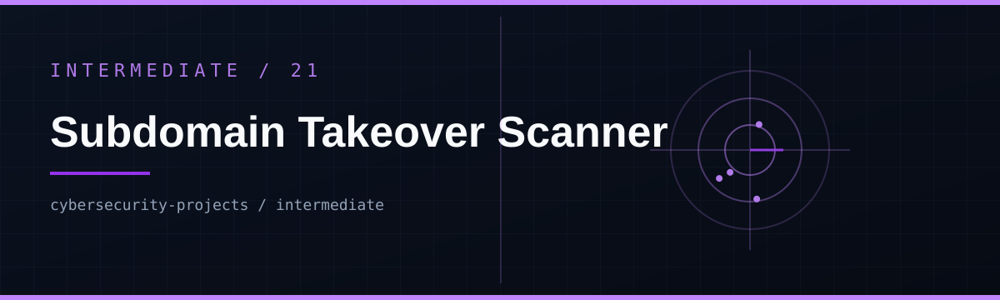
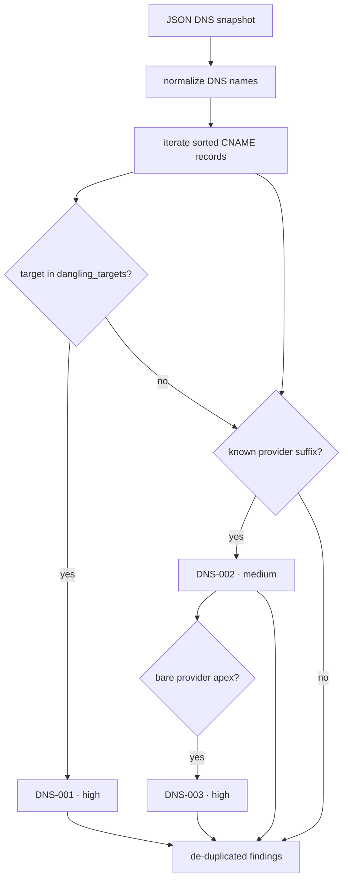

<div align="center">
  
</div>

<br />

<div align="center">

# 🧭 Subdomain Takeover Scanner


> **Stale CNAMEs don't resolve themselves.** An offline snapshot analyzer that spots dangling targets and takeover-prone provider patterns before someone else does.

</div>

---

## 🎯 What it does

Upstream is Go and the synopsis is offensive. This build is a **defensive substitution in Python**: it analyzes CNAME records that you supply in a JSON snapshot. It performs **no live DNS queries**, opens no sockets, and never attempts to claim a resource. No network or live DNS resolution is used.

`dangling_targets` is an observation supplied by the snapshot; the tool does not verify it over the network.

| Check | Meaning |
| --- | --- |
| `DNS-001` | CNAME target explicitly marked dangling in the snapshot. |
| `DNS-002` | CNAME target matches a known takeover-prone provider domain (longest suffix wins). |
| `DNS-003` | CNAME points at a bare provider domain rather than a tenant-specific target. |

## 🧠 How it works



Provider matching is suffix-based with the most specific domain winning, so `tenant.eu.pages.test` can be attributed to a regional service rather than a broader parent.

## 🚀 Quick start

```powershell
python dns_snapshot_analyzer.py snapshot.json
python dns_snapshot_analyzer.py snapshot.json --json
```

Example `snapshot.json` (all names are synthetic):

```json
{
  "cname_records": [
    {"host": "blog.example.test", "target": "demo-user.pages.test."},
    {"host": "old.example.test", "target": "unclaimed.hosting.test"},
    {"host": "landing.example.test", "target": "pages.test"}
  ],
  "known_services": [
    {
      "provider": "Demo Pages",
      "domains": ["pages.test"],
      "note": "Check that the custom domain is still bound."
    }
  ],
  "dangling_targets": ["unclaimed.hosting.test"]
}
```

### Real output

```text
$ python dns_snapshot_analyzer.py snapshot.json
[HIGH  ] DNS-001 old.example.test: CNAME target unclaimed.hosting.test is marked dangling in the snapshot -> Remove the stale CNAME or point it at a resource you control.
[MEDIUM] DNS-002 blog.example.test: CNAME target demo-user.pages.test matches known provider Demo Pages. Check that the custom domain is still bound. -> Verify custom-domain configuration and remove unused provider bindings.
[MEDIUM] DNS-002 landing.example.test: CNAME target pages.test matches known provider Demo Pages. Check that the custom domain is still bound. -> Verify custom-domain configuration and remove unused provider bindings.
[HIGH  ] DNS-003 landing.example.test: CNAME target is the bare provider domain pages.test -> Use a fully qualified tenant-specific target instead of a provider apex.
findings: 4
```

## 📂 Project structure

```text
21-subdomain-takeover-scanner/
├── assets/hero.svg                       # generated visual identity
├── dns_snapshot_analyzer.py              # snapshot model + checks + CLI
├── learn/README.md                       # the concepts behind dangling CNAMEs
└── tests/test_dns_snapshot_analyzer.py   # 7 deterministic tests
```

## 🔍 Why it matters

- **Orphaned DNS entries are inventory debt.** A CNAME outliving its hosted service is a foothold waiting to be claimed.
- **Bare provider apexes are suspicious.** Tenant-specific targets are expected; an apex often means a binding was removed.
- **Provider specificity matters.** Longest-suffix matching avoids mislabeling a regional target as a generic one.
- **Evidence stays with the operator.** Every verdict comes from the supplied snapshot, so results are auditable and reproducible.

## 🧪 Tests

```powershell
python -m unittest discover -s tests -v
```

7 deterministic tests covering DNS normalization, snapshot parsing, longest-suffix provider matching, dangling targets, provider and apex findings, clean snapshots, and JSON CLI output. No network or live DNS resolution is used.

## 📚 Learn more

Read [the concept notes](learn/README.md) for CNAME delegation, dangling resource mechanics, and why snapshot-only analysis is enough to prioritize cleanup.

---

<div align="center">
  <sub>Part of <b>cybersecurity-projects</b> · Intermediate tier · Built from a synopsis, original implementation.</sub>
</div>
