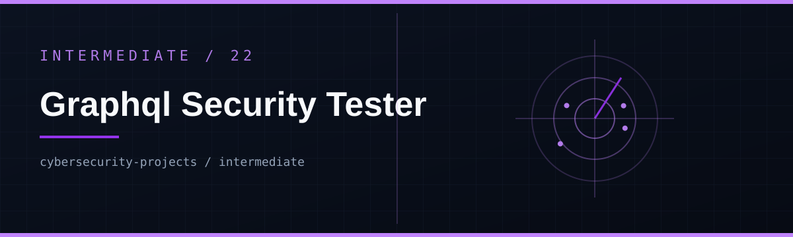
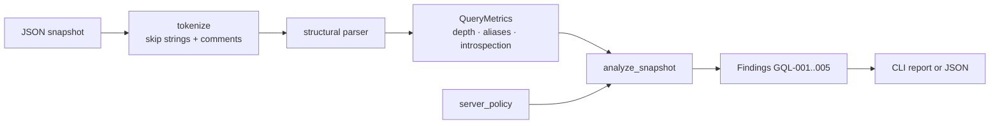

<div align="center">
  
</div>

<br />

<div align="center">

# 🧩 GraphQL Security Tester


> **Measure the query, not the server.** A tiny structural analyzer that flags depth, introspection, alias, and batching risk from text alone.

</div>

---

## 🎯 What it does

This is a **Python offline query analyzer**. It reads GraphQL query text and a declared server policy from a JSON snapshot. There is no live endpoint, no HTTP client, and no network access. This tool reports risk indicators; it does not send queries anywhere.

Braces inside strings and comments are ignored by the small built-in tokenizer. Queries may also be plain strings. `server_policy.max_depth` is used to detect missing or overly permissive depth limits.

| Check | Trigger |
| --- | --- |
| `GQL-001` | Selection depth above 8. |
| `GQL-002` | `__schema` or `__type` introspection fields. |
| `GQL-003` | More than 10 aliases in one query. |
| `GQL-004` | More than 5 operations in the supplied batch. |
| `GQL-005` | Server depth limit missing/non-positive (high) or above 20 (medium). |

## 🧠 How it works



The parser records metrics without building a full AST: selection sets are walked recursively, alias colons are counted, and introspection field names are collected as they are encountered.

## 🚀 Quick start

```powershell
python graphql_analyzer.py snapshot.json
python graphql_analyzer.py snapshot.json --json
```

Example `snapshot.json` (synthetic queries):

```json
{
  "queries": [
    {"name": "deep", "query": "query deep { a { a { a { a { a { a { a { a { a { id } } } } } } } } } }"},
    {"name": "aliases", "query": "query aliases { alias0: user { id } alias1: user { id } alias2: user { id } alias3: user { id } alias4: user { id } alias5: user { id } alias6: user { id } alias7: user { id } alias8: user { id } alias9: user { id } alias10: user { id } }"},
    {"name": "introspect", "query": "query i { __schema { types { name } } }"},
    {"name": "small0", "query": "{ viewer { id } }"},
    {"name": "small1", "query": "{ viewer { id } }"},
    {"name": "small2", "query": "{ viewer { id } }"},
    {"name": "small3", "query": "{ viewer { id } }"}
  ],
  "server_policy": {
    "max_depth": 50,
    "max_aliases": 10,
    "max_batch_size": 5
  }
}
```

### Real output

```text
$ python graphql_analyzer.py snapshot.json
[HIGH  ] GQL-001 Excessive query nesting: depth exceeds 8: deep=10 -> Enforce a server-side depth limit and reject oversized selections.
[MEDIUM] GQL-002 Schema introspection requested: introspect=__schema -> Disable introspection outside development or require authorization.
[MEDIUM] GQL-003 Alias-heavy query: aliases exceed 10: aliases=11 -> Apply an alias-count limit and query-cost accounting.
[MEDIUM] GQL-004 Oversized request batch: batch_size=7 exceeds 5 -> Limit the number of operations accepted in a single request.
[MEDIUM] GQL-005 Server-side depth limit is too permissive: server_policy.max_depth=50 exceeds 20 -> Lower the configured maximum query depth.
findings: 5
```

## 📂 Project structure

```text
22-graphql-security-tester/
├── assets/hero.svg                  # generated visual identity
├── graphql_analyzer.py              # tokenizer + parser + checks + CLI
├── learn/README.md                  # the concepts behind query-risk analysis
└── tests/test_graphql_analyzer.py   # 8 deterministic tests
```

## 🔍 Why it matters

- **Depth is a cheap DoS vector.** A deeply nested selection can force expensive resolution work before any authorization logic runs.
- **Aliases multiply work.** Eleven aliases on one field can look like one query while costing far more.
- **Introspection leaks shape.** Schema visibility outside development hands an attacker a map.
- **Policy text is evidence.** Comparing declared limits to observed query shapes makes configuration drift visible without touching an endpoint.

## 🧪 Tests

```powershell
python -m unittest discover -s tests -v
```

8 deterministic tests covering tokenizer behavior, depth and alias measurement, introspection detection, deep and alias-heavy findings, batch size, depth-policy severities, clean snapshots, and JSON CLI output. No queries are sent anywhere.

## 📚 Learn more

Read [the concept notes](learn/README.md) for query-depth limits, alias amplification, introspection controls, and batching defenses.

---

<div align="center">
  <sub>Part of <b>cybersecurity-projects</b> · Intermediate tier · Built from a synopsis, original implementation.</sub>
</div>
