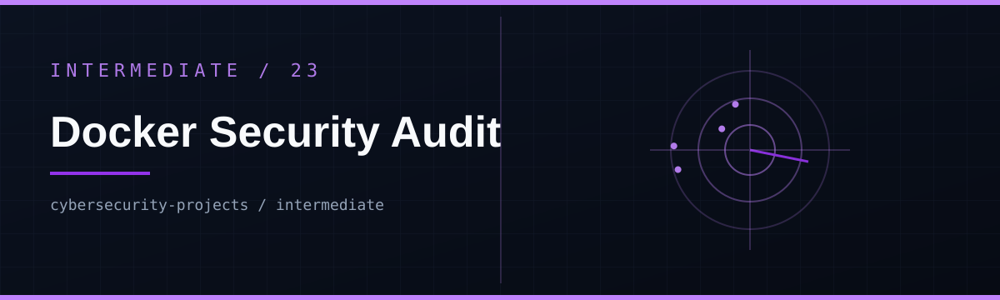
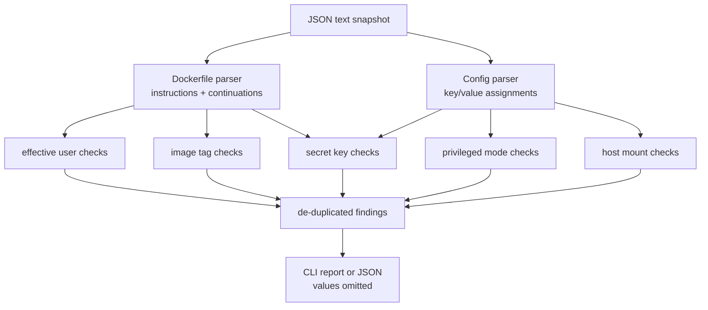

<div align="center">
  
</div>

<br />

<div align="center">

# 🐳 Docker Security Audit


> **Audit the manifest, not the machine.** A text-only hardening check for Dockerfiles and compose-like config, with secret values never printed.

</div>

---

## 🎯 What it does

Upstream is Go; this build is a **Python substitution**. It parses a Dockerfile and compose-like config **text snapshot** and flags container hardening indicators. There is no Docker daemon access, no image build, and no container execution. Only text is parsed; no real credentials or daemon access are used.

Use `config` or `compose` as the key for the config text.

| Check | What it flags |
| --- | --- |
| `DOCK-001` | Explicit root user (high) or no user declared (medium). |
| `DOCK-002` | Privileged mode enabled in config or flags. |
| `DOCK-003` | Host bind mounts; sensitive host paths such as `/var/run/docker.sock` are high severity. |
| `DOCK-004` | `:latest` tags and implicit latest tags; digest pins are ignored. |
| `DOCK-005` | Inline secret-like keys in `ENV`, `ARG`, or config. **Values are never printed.** |

## 🧠 How it works



Sensitive host paths are matched as exact paths or path prefixes, so `/var/run/docker.sock` is treated as high severity while `./data` is medium. Secret-like keys are reported by name only; the parser deliberately drops the value from the finding detail.

## 🚀 Quick start

```powershell
python docker_audit.py snapshot.json
python docker_audit.py snapshot.json --json
```

Example `snapshot.json` (all values are synthetic):

```json
{
  "dockerfile": "FROM ubuntu:latest\nUSER root\nENV API_TOKEN=demo-not-real\n",
  "config": "services:\n  app:\n    image: nginx\n    privileged: true\n    volumes:\n      - /var/run/docker.sock:/var/run/docker.sock\n      - ./data:/data\n    environment:\n      - CLIENT_SECRET=demo-not-real\n"
}
```

### Real output

```text
$ python docker_audit.py snapshot.json
[HIGH  ] DOCK-001 Container runs as root: effective user is root -> Add a non-root USER instruction or run the container with a non-root identity.
[HIGH  ] DOCK-002 Privileged mode requested: privileged mode is enabled in the snapshot -> Remove privileged mode and grant only the specific capabilities required.
[MEDIUM] DOCK-003 Host path mounted into container: host path ./data mapped to /data -> Avoid bind mounts of host paths; use named volumes or restricted, explicit paths.
[HIGH  ] DOCK-003 Host path mounted into container: host path /var/run/docker.sock mapped to /var/run/docker.sock -> Avoid bind mounts of host paths; use named volumes or restricted, explicit paths.
[MEDIUM] DOCK-004 Image tag is implicit latest: image nginx has no explicit tag -> Add an explicit version tag or digest.
[MEDIUM] DOCK-004 Mutable latest image tag: image ubuntu:latest uses :latest -> Pin images to a specific version or digest for reproducible builds.
[HIGH  ] DOCK-005 Potential secret in build/config text: API_TOKEN in Dockerfile ENV has an inline value (value omitted) -> Inject secrets at runtime from a secret manager; never bake them into images or config.
[HIGH  ] DOCK-005 Potential secret in build/config text: CLIENT_SECRET in config has an inline value (value omitted) -> Inject secrets at runtime from a secret manager; never bake them into images or config.
findings: 8
```

## 📂 Project structure

```text
23-docker-security-audit/
├── assets/hero.svg                # generated visual identity
├── docker_audit.py                # text parsers + checks + CLI
├── learn/README.md                # the concepts behind container hardening
└── tests/test_docker_audit.py     # 8 deterministic tests
```

## 🔍 Why it matters

- **Defaults are dangerous.** An absent `USER` or an implicit `:latest` is a decision by omission, not a safe default.
- **Privilege and mounts compound.** Privileged mode plus a Docker socket bind effectively hands over the host.
- **Reproducibility is security.** Pinned tags and digests make builds auditable and reviewable.
- **Reports must be safe too.** Naming a secret key without echoing its value preserves the usefulness of the finding without creating a new leak.

## 🧪 Tests

```powershell
python -m unittest discover -s tests -v
```

8 deterministic tests covering Dockerfile continuations, root and missing-user findings, privileged mode, host mounts, mutable tags, secret values being omitted, clean snapshots, config parsing, and the CLI. No real credentials or daemon access are used.

## 📚 Learn more

Read [the concept notes](learn/README.md) for non-root containers, capability reduction, mount hygiene, and secret injection patterns.

---

<div align="center">
  <sub>Part of <b>cybersecurity-projects</b> · Intermediate tier · Built from a synopsis, original implementation.</sub>
</div>
