

  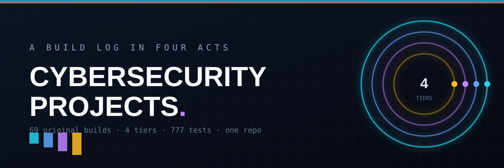

# 🟣 Intermediate

> Detection pipelines, risk analysis and offline labs.

---

## All intermediate projects

| Project | Banner | What it does |
|---|---|---|
| [Security News Scraper](01-security-news-scraper/README.md) | 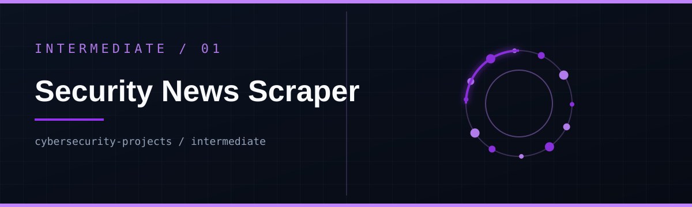 | Offline RSS/Atom parsing and relevance ranking. |
| [Payload Obfuscation Engine](02-payload-obfuscation-engine/README.md) | 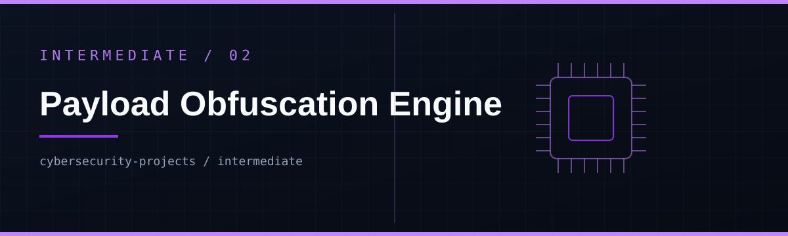 | Detect layered encoding and obfuscation in files. |
| [Siem Dashboard](03-siem-dashboard/README.md) | 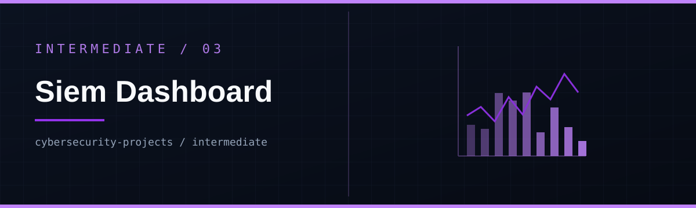 | Correlate JSONL events into counts and alerts. |
| [Token Abuse Playground](04-token-abuse-playground/README.md) | 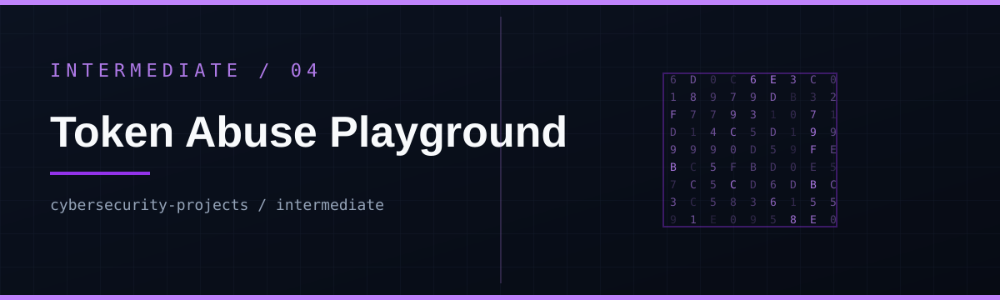 | Parse-only inspection of JWT-like token claims. |
| [Supply Chain Attack Simulator](05-supply-chain-attack-simulator/README.md) | 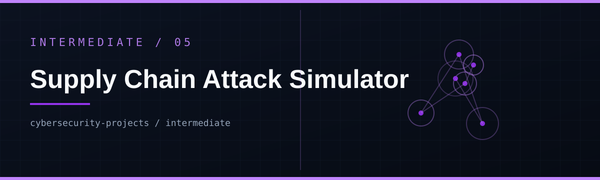 | Dependency-graph risk analysis and typosquat checks. |
| [Ddos Mitigation Tool](06-ddos-mitigation-tool/README.md) | 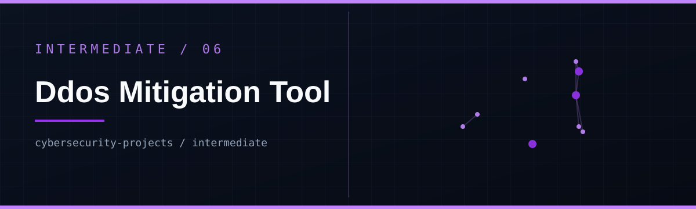 | Token-bucket and sliding-window traffic shaping. |
| [Secrets Scanner](07-secrets-scanner/README.md) | 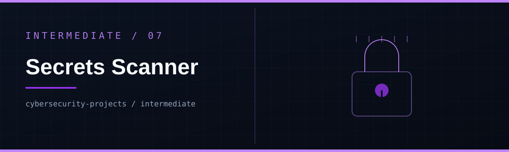 | Regex and entropy detection with suppression support. |
| [Api Security Scanner](08-api-security-scanner/README.md) |  | Static OpenAPI security and authentication checks. |
| [Wireless Deauth Detector](09-wireless-deauth-detector/README.md) | 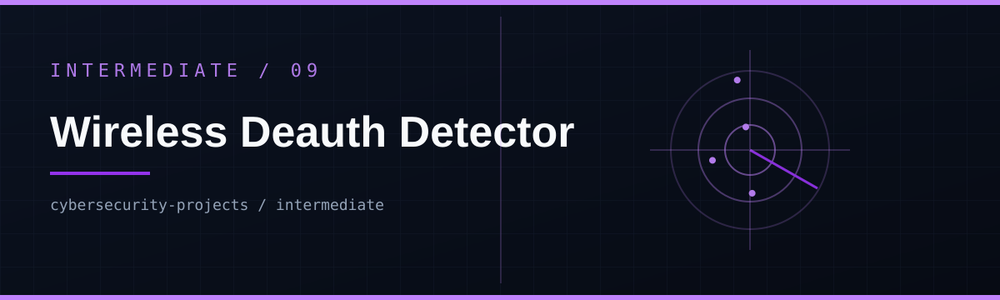 | Flood detection in synthetic 802.11 frame logs. |
| [Credential Enumeration Detector](10-credential-enumeration-detector/README.md) | 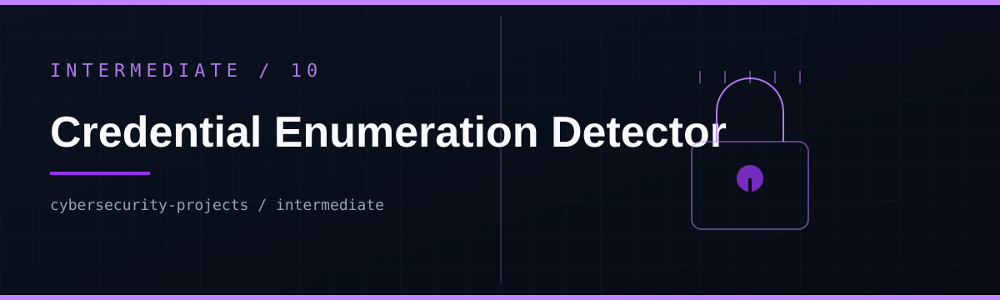 | Find enumeration leaks in recorded login results. |
| [Binary Analysis Tool](11-binary-analysis-tool/README.md) | 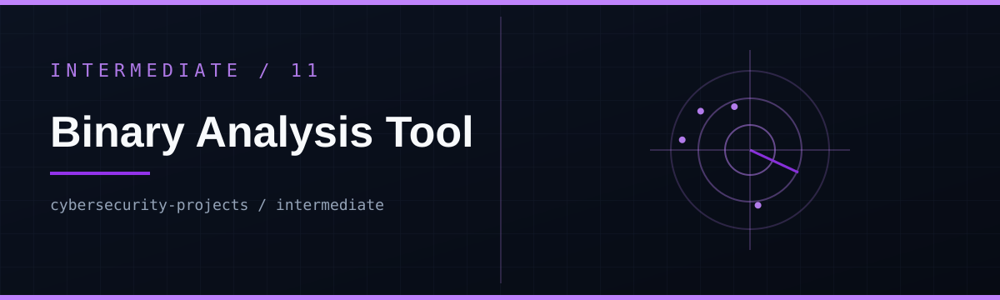 | Pure-Python ELF and PE header inspection. |
| [Chaos Engineering Security Tool](12-chaos-engineering-security-tool/README.md) | 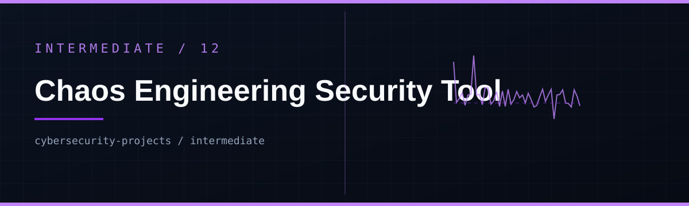 | Plan and simulate fault scenarios safely. |
| [Credential Rotation Enforcer](13-credential-rotation-enforcer/README.md) | 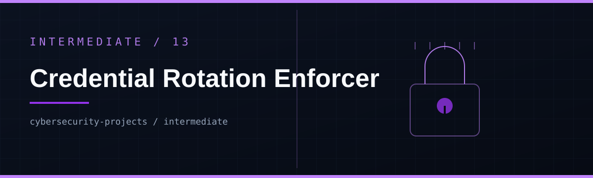 | Policy checks over rotation metadata only. |
| [Race Condition Detector](14-race-condition-detector/README.md) | 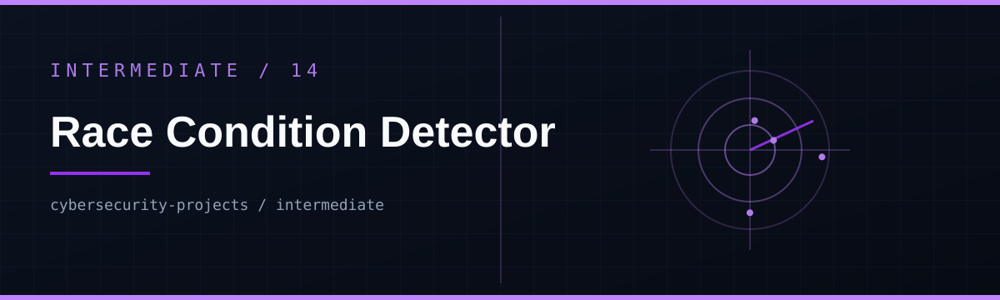 | Spot TOCTOU patterns in logs and code snapshots. |
| [Ja3 Ja4 Fingerprinting Tool](15-ja3-ja4-fingerprinting-tool/README.md) | 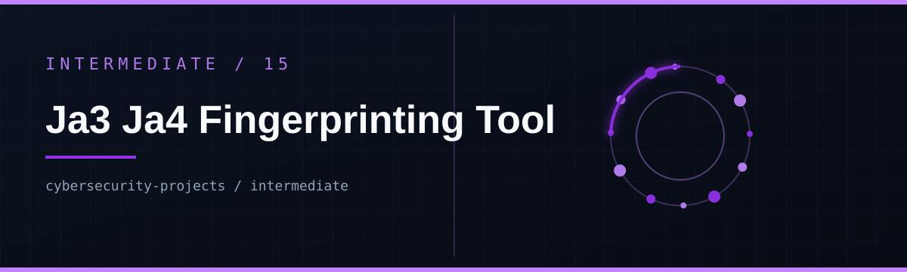 | Compute TLS fingerprint hashes from field lists. |
| [Mobile App Security Analyzer](16-mobile-app-security-analyzer/README.md) | 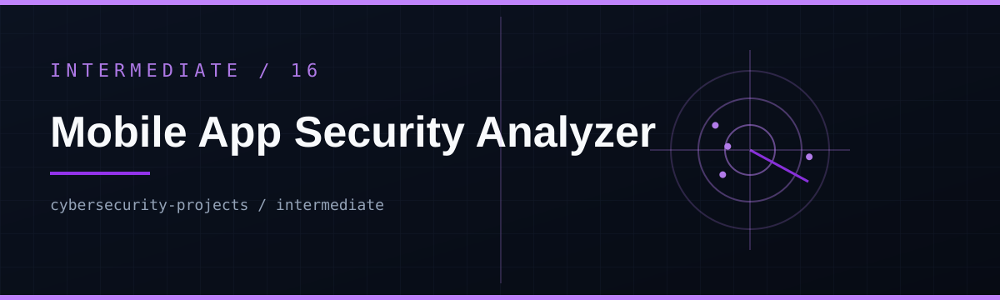 | Manifest checks for permissions and exported components. |
| [Dlp Scanner](17-dlp-scanner/README.md) | 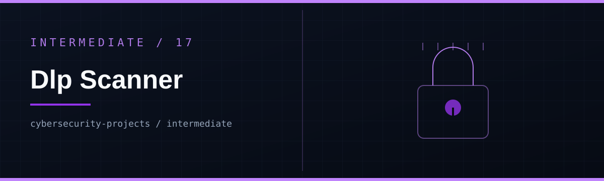 | PII and secret detection with severity and redaction. |
| [Nginx Edge Rule Engine](18-nginx-edge-rule-engine/README.md) | 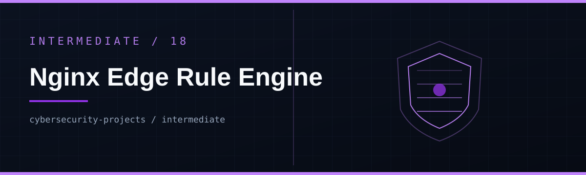 | Evaluate path, method, CIDR and header edge rules. |
| [Privesc Playground](19-privesc-playground/README.md) | 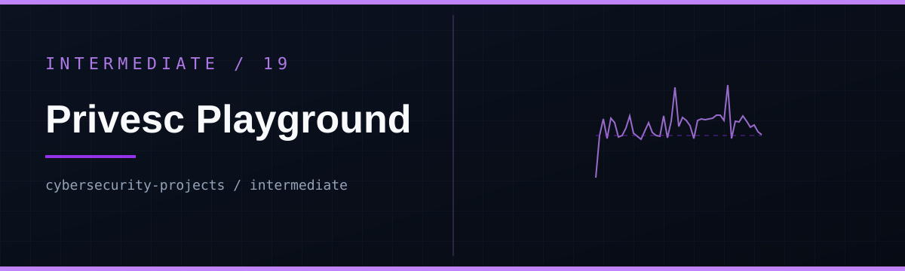 | Audit SUID, sudoers and writable-path risk indicators. |
| [Sbom Generator and Vulnerability…](20-sbom-generator-and-vulnerability-matcher/README.md) | 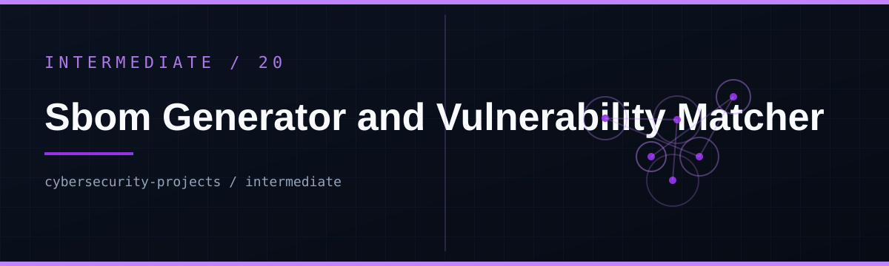 | CycloneDX-like SBOM with local CVE matching. |
| [Subdomain Takeover Scanner](21-subdomain-takeover-scanner/README.md) | 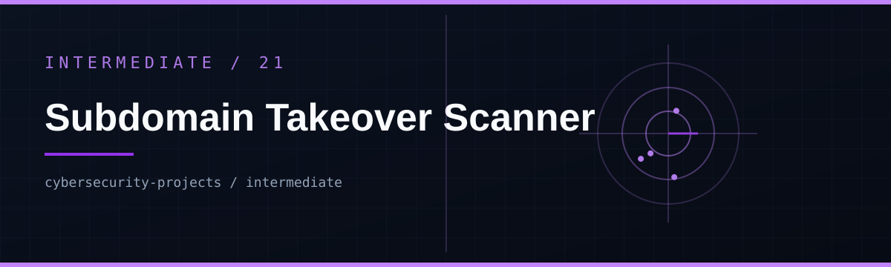 | Dangling CNAME analysis over a DNS snapshot. |
| [Graphql Security Tester](22-graphql-security-tester/README.md) | 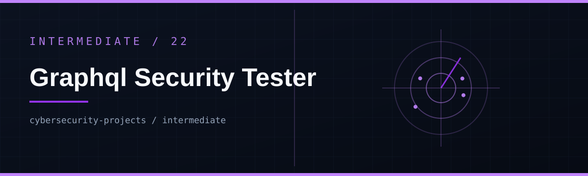 | Offline depth, introspection and alias-abuse checks. |
| [Docker Security Audit](23-docker-security-audit/README.md) | 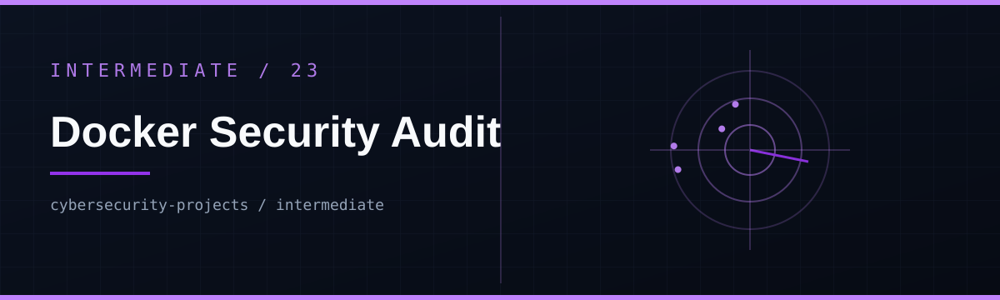 | Dockerfile policy checks with no daemon access. |

---

[← Back to the full gallery](../README.md)

